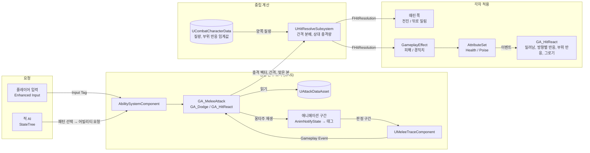

# 3인칭 격투 액션 포트폴리오 계획 (가칭: FirstAction)

> 대상 직무: Unreal Engine 클라이언트 리드 개발자
> https://www.iiccareers.com/ko/o/242685
> 자매 프로젝트: FirstVR (VR 슈팅, 컴포넌트 조합형 무기 시스템)

---

## 1. 공고와 포트폴리오의 연결

공고의 게임은 **콘솔/PC용 AAA 세미 오픈월드 어드벤처**이고, 담당 업무의 중심은 전투, 애니메이션, AI다.
포트폴리오의 모든 기능은 아래 표의 어느 한 칸을 증명하기 위해 존재한다. 표에 연결되지 않는 기능은 만들지 않는다.

| 공고 항목 | 포트폴리오에서 보여줄 것 |
|---|---|
| 플레이어 인터랙션, 스킬 시스템, 애니메이션 기반 조작감 | GAS 기반 공격/회피/스킬, 애니메이션 구간(입력 버퍼, 캔슬, 무적), 히트스톱, 모션 워핑 |
| NPC 및 적 AI 행동 로직, 전투 패턴 설계, 전투 시스템 고도화 | StateTree AI, 데이터 기반 패턴 선택, 공격 토큰(동시 공격 수 제어), 경직치 |
| 기획 의도를 빠르게 프로토타입으로 구현 | 새 공격, 새 적을 **C++ 추가 없이** 데이터와 에셋만으로 제작 |
| 기존 게임을 역기획해 기술 구현용 문서로 정리 | 데빌 메이 크라이의 타격 반응(밀려나는 적, 콤보 마무리 타격)을 역기획 → 기술 명세 → 실제 구현 |
| 기술 이슈 분석 및 해결 | 저 프레임에서 공격 판정 누락 문제와 해결(서브스텝 스윕), Unreal Insights 측정 |
| 리드 경험, 개발 프로세스 개선 | 에셋 분리 구조, 데이터 검증, 기본/배포 두 가지 빌드 자동화 |

---

## 2. 핵심 설계 메시지

> **"플레이어와 적은 같은 전투 코어를 쓰고, 공격 하나는 데이터 한 장이다."**

1. **요청과 실행의 분리**: 플레이어 입력과 AI 판단은 모두 "이 어빌리티를 실행해 달라"는 요청만 보낸다. 어빌리티는 누가 요청했는지 모른다.
2. **공격은 데이터**: 몽타주, 피해, 경직치, 히트스톱, 콤보 분기, 모션 워핑 거리 등 공격의 모든 성질은 공격 데이터 에셋에 있다. 공격 어빌리티는 하나뿐이다.
3. **타이밍은 애니메이션, 의미는 태그**: "언제 맞는가, 언제 캔슬되는가"는 애니메이션 위의 노티파이 구간이 정하고, 코드는 그 구간이 켜는 게임플레이 태그의 의미만 안다.
4. **계산은 중립 매니저가 하고, 적용은 각자 한다**: 한 번의 타격으로 맞는 쪽뿐 아니라 때린 쪽도 움직인다. 그래서 양쪽 정보를 모두 보는 타격 해석 매니저가 결과를 계산하고, 각 캐릭터는 자기 몫의 결과만 자기 몸에 적용한다. (4.6)
5. **간격은 공격이 정하고, 나누는 비율은 질량이 정한다**: 타격 후 두 캐릭터 사이 간격은 공격 데이터에 있고, 그 간격을 누가 얼마나 만들지는 질량 비율로 정한다. (4.6)

FirstVR의 원칙(코어는 구체 타입을 모르고, 데이터가 흐름을 정한다)을 근접 전투로 옮긴 것이다. PDF에서 두 프로젝트를 같은 원칙의 두 가지 적용으로 묶어 보여줄 수 있다.

---

## 3. 게임 범위

### 3.1 플레이 한 사이클 (3~5분)

짧은 진입 통로(이동, 락온 연습) → 일반 적 그룹 전투 2회 → 엘리트 적 1체(패턴 3~4개) → 종료

### 3.2 플레이어

- 약 공격 / 강 공격 콤보 (콤보 분기 포함)
- 회피 (무적 구간, 공격 캔슬)
- 방어 3종: 가드 / 패리 / 저스트 회피. 모두 타격 해석 매니저의 규칙으로 구현한다 (4.6)
- 락온
- 스킬 1~2개 (예: 돌진기, 범위기)

### 3.3 폴리싱 우선순위

1. **공격** (최우선, 가장 깊게): 콤보 간격, 질량 분배, 히트스톱, 부위 반응, 마무리 타격
2. 방어 3종: 동작하고 구분되는 수준까지
3. 적 AI, 락온, 스킬

### 3.4 적

- **일반형**: 공격 토큰을 얻어야 공격, 토큰이 없으면 거리 유지와 측면 이동
- **엘리트형**: 거리별 패턴 선택, 예비 동작(텔레그래프), 경직치가 높아 그로기 유도가 목표

### 3.5 범위 밖

- 무기 교체, 인벤토리, 성장 시스템
- 오픈월드 스트리밍, 스토리 연출
- 멀티플레이 (네트워크 복제는 고려만 하고 구현하지 않음)
- 적이 플레이어 공격 예고를 보고 회피하는 반응 (템플릿의 `NotifyDanger` 흐름, `Docs/TemplateReview.md`)

---

## 4. 기술 구조

### 4.1 전체 구조



### 4.2 GAS 사용 범위

| 요소 | 내용 |
|---|---|
| ASC 위치 | 캐릭터에 직접 부착 (싱글플레이, 리스폰 시 어빌리티 상태는 이어지지 않고 초기화). Lyra처럼 PlayerState에 두는 방식과의 차이를 PDF에서 한 줄로 설명 |
| AttributeSet | `Health`, `MaxHealth`, `Poise`(경직치), `MaxPoise` (필요 시 `Stamina`) |
| 어빌리티 | `GA_MeleeAttack`(범용), `GA_Dodge`, `GA_HitReact`(이벤트로 발동), 방어 어빌리티 1종, 스킬 |
| 이펙트 | `GE_Damage`(SetByCaller로 피해/경직치 전달), 무적, 경직치 회복 |
| 태그 | `State.Attacking`, `State.Dodging`, `State.Invulnerable`, `State.Guarding`, `State.Staggered`, `Window.Combo`, `Window.Cancel`, `Window.Parry`, `Window.JustDodge`, `Event.Hit`, `InputTag.LightAttack` 등 |

### 4.3 공격 데이터 (`UAttackDataAsset : UPrimaryDataAsset`)

| 칸 | 의미 |
|---|---|
| `Montage` | 재생할 공격 몽타주 |
| `Damage` | 피해량 (SetByCaller로 전달) |
| `ImpactForce` | 충격 크기와 방향 (때린 쪽 기준 방향). 경직치 감소와 반응 단계는 이 값으로 계산된다 |
| `PostHitSpacing` | 타격 직후 두 캐릭터 사이에 남아야 할 간격. 콤보 중간 타격은 다음 공격이 닿는 거리, 마무리 타격은 크게 벌린다 |
| `HitStopDuration` | 맞았을 때 양쪽 캐릭터를 멈추는 시간 |
| `AttackBone` | 공격하는 팔의 기준 본 (예: `upperarm_r`). 패리 당했을 때 부위 반응을 주는 위치 |
| `MaxWarpDistance` | 공격 시작 시 모션 워핑으로 대상에게 붙는 최대 거리 |
| `ComboLinks` | `{입력 태그, 다음 공격 데이터}` 목록. 콤보 분기 정보는 여기에만 있다 |
| `CameraShake` | 피격 시 카메라 흔들림 |

### 4.4 애니메이션 구간

| 노티파이 스테이트 | 하는 일 |
|---|---|
| `ANS_TagWindow` (범용, 태그를 파라미터로 받음) | 구간 동안 ASC에 태그를 붙였다 뗀다. `Window.Combo`, `Window.Cancel`, `State.Invulnerable`을 모두 이 클래스 하나로 처리 |
| `ANS_HitWindow` | 구간 동안 지정한 소켓 쌍으로 판정 트레이스를 켠다 |
| `AN_Telegraph` | 적의 예비 동작 시점에 VFX/사운드/UI 신호 |

- **입력 버퍼**: 공격 중 들어온 입력을 짧은 시간(데이터값) 보관하고, `Window.Combo`가 열리는 순간 소비한다.
- C++에 프레임 번호나 초 단위 타이밍을 하드코딩하지 않는다.

### 4.5 피격 판정과 피해

- `UMeleeTraceComponent`: 이전 프레임과 현재 프레임의 소켓 위치 사이를 스윕한다. 프레임이 낮을 때 판정이 누락되는 문제를 **서브스텝 보간**으로 해결한다(기술 이슈 해결 사례로 PDF에 사용).
- 한 번의 휘두름에서 같은 대상은 한 번만 맞는다.
- 판정 → `Event.Hit` 게임플레이 이벤트 → 공격 어빌리티가 타격 정보를 타격 해석 매니저에 넘긴다 (4.6) → 결과로 대상에게 `GE_Damage` 적용 → 대상 AttributeSet의 `PostGameplayEffectExecute`에서 경직치 감소, 0이면 그로기 이벤트.
- 히트스톱: 양쪽 액터의 `CustomTimeDilation`을 데이터 시간만큼 낮춘다.

### 4.6 타격 해석과 피격 반응 (역기획: 데빌 메이 크라이)

**레퍼런스에서 가져온 것**: 플레이어의 공격에 적이 적절히 밀려나고, 콤보 마무리 타격은 적을 화끈하게 밀어낸다.

**설계 결론**

1. **간격은 공격이 정한다.** 콤보 중간 타격마다 크게 밀려나면 적이 다음 공격 범위를 벗어나 콤보가 끊긴다. 그래서 타격 후 간격(`PostHitSpacing`)을 공격 데이터가 가진다.
2. **간격을 누가 얼마나 만들지는 질량 비율이 정한다.** 어느 경우든 타격 후 간격은 같다.
   - 작은 적: 적이 크게 밀려나고, 플레이어는 앞으로 붙는다 (모션 워핑)
   - 큰 적: 적은 조금만 밀려나고, 플레이어가 뒤로 밀린다
3. **계산은 중립 매니저가 한다.** `UHitResolveSubsystem : UWorldSubsystem`이 양쪽 정보를 받아 결과를 계산하고, 각 캐릭터는 자기 몫만 적용한다.
4. **부위 반응은 임계값 이상일 때만 준다.** 모든 타격에 주면 적이 가벼워 보인다. 적 크기 대비 충격이 임계값 이상일 때만 맞은 본 아래에 물리 반응을 준다. (FirstVR의 물리 피격 반응 방식 재사용)

**매니저 입력**

| 정보 | 출처 |
|---|---|
| 충격 벡터 (방향, 크기) | 공격 데이터 `ImpactForce` |
| 타격 후 간격 | 공격 데이터 `PostHitSpacing` |
| 질량 (때린 쪽, 맞는 쪽 모두) | 공통 캐릭터 데이터 `UCombatCharacterData` |
| 맞은 본, 피격 위치 | 판정 결과 |

**매니저 출력 (`FHitResolution`)**

| 결과 | 쓰는 곳 |
|---|---|
| 때린 쪽 이동량 (전진 또는 뒤로 밀림) | 때린 쪽 캐릭터 |
| 맞는 쪽 이동량 | 맞는 쪽 `GA_HitReact` |
| 상대 충격량 (충격 ÷ 맞는 쪽 질량) | 경직치 감소량, 반응 단계, 부위 반응 여부 |
| 맞은 본, 방향 | 방향별 반응 몽타주, 부위 반응 |

- 상대 충격량은 매니저가 **한 번만** 계산해서 넘긴다. 받는 쪽마다 따로 나누면 같은 계산이 여러 곳에 흩어진다.
- 질량 비율 분배 공식과 상대 충격량 → 경직치 변환식은 Step 6에서 수치를 보며 정한다.

**공통 캐릭터 데이터 (`UCombatCharacterData`)**

- `Mass`: 플레이어와 적 모두 가진다
- `PartialReactionThreshold`: 부위 반응을 주는 상대 충격량 기준
- 반응 단계 기준값 (움찔 / 경직 / 넘어짐)
- 방향별 반응 몽타주 매핑

**피격 반응 단계**

- 상대 충격량과 남은 경직치로 반응 단계 결정 (움찔 / 경직 / 넘어짐 / 그로기)
- 맞은 방향 4방향 판정으로 반응 몽타주 선택
- 임계값 이상이면 맞은 본 아래에 물리 반응을 블렌딩 (`PhysicalAnimationComponent` 또는 본 아래 물리 블렌드)

**방어 규칙**

방어는 별도 시스템이 아니다. 매니저가 **맞는 쪽 상태 태그**를 보고 `FHitResolution`을 바꾸는 규칙이다.

| 방어 | 판단 태그 | 간격 이동 | 피해 | 상대 충격량 | 결과 |
|---|---|---|---|---|---|
| 가드 | `State.Guarding` | 일반 타격과 같음 (연속 공격을 계속 받아내도록) | 없음 또는 감소 | 방어자 | 밀리면서 버틴다 |
| 패리 | `Window.Parry` | 양쪽 모두 없음 | 없음 | **공격자에게 반대 방향으로 되돌림** | 공격자의 `AttackBone` 아래 부위 반응 + 튕겨 나가는 애니메이션 + 경직. 방어자가 먼저 공격할 기회를 얻는다 |
| 저스트 회피 | `Window.JustDodge` | 공격자는 공격 데이터대로, 방어자는 회피 방향으로 | 없음 | 없음 | 위치를 빼고 다음 행동 준비 |

- 패리는 새 기능 없이 충격 벡터 반전 + 부위 반응 + 경직 태그를 재사용한다.
- 패리로 생긴 경직 태그는 적 AI와 공격 토큰이 보고 공격을 멈추는 기준이 된다.
- `Window.Parry`, `Window.JustDodge` 구간을 어디에 두는지(가드 시작 직후, 회피 시작 직후 등)는 Step 6에서 질문으로 정한다.

### 4.7 적 AI

- **StateTree** (제안. Behavior Tree와 비교는 9장 결정 목록)
  - `Idle` → `Engage` → { `Approach` / `Strafe` / `Attack` / `Recover` } → `Staggered` → `Dead`
- **패턴 데이터** (`UEnemyPatternDataAsset`): `{공격 데이터, 최소/최대 거리, 쿨다운, 가중치, 토큰 필요 여부}` 목록
- **공격 토큰** (`UCombatTokenSubsystem : UWorldSubsystem`): 동시에 공격할 수 있는 적 수를 한 곳에서 제어. 공격 종료, 피격, 사망 시 반납.
- AI는 패턴을 **선택**만 하고, 실행은 플레이어와 같은 `GA_MeleeAttack`이 한다.

### 4.8 카메라와 락온

- `ULockOnComponent`: 화면 중앙 가중치 기반 대상 선택, 대상 전환, 거리 이탈 시 해제
- 락온 시 카메라 보간, 공격 시 모션 워핑 대상으로 사용

---

## 5. 에셋 정책: 깃에는 기본 에셋, 배포 빌드에는 유료 에셋

### 5.1 폴더

```
Content/
├── Portfolio/        # (git) 직접 만든 블루프린트, 데이터, 레벨, 기본 세트
├── Characters/       # (git) 템플릿 기본 마네킹
├── Portfolio/Animations/Quaternius/  # (git) CC0 원본 임포트와 IK Rig/Retargeter (5.3 참고)
├── Portfolio/Animations/Retargeted/  # (git) 마네킹으로 리타깃한 결과
└── ThirdParty/       # (git 제외) Fab 유료 원본 + 이를 참조하는 몽타주, Release 세트
```

### 5.2 규칙

1. **`Portfolio/` → `ThirdParty/` 하드 참조 금지.** 깃을 클론한 사람이 바로 열고 실행할 수 있어야 한다.
2. **모든 애니메이션은 UE5 마네킹 스켈레톤 기준.** 유료 애니메이션은 IK Retargeter로 마네킹에 리타깃해 `ThirdParty/`에 저장한다.
3. **소켓과 노티파이 이름 규약을 공유**한다. 유료 애니메이션에도 같은 이름의 노티파이 구간을 찍는다.
4. **콘텐츠 세트** (`UCombatContentSet : UPrimaryDataAsset`): 캐릭터 메시, 애니메이션 블루프린트, 공격 데이터 목록, 적 구성.
   - `Default` 세트: `Portfolio/Data/` (git)
   - `Release` 세트: `ThirdParty/Data/` (git 제외)
5. **선택과 폴백**: `UPortfolioContentSettings : UDeveloperSettings`에 `Release` 세트를 소프트 참조로 지정한다. 로드에 실패하면 `Default`로 폴백하고 로그를 남긴다.
6. **쿡 포함 보장**: Asset Manager에 `CombatContentSet` 기본 에셋 타입을 등록해 Release 세트가 패키지에 들어가게 한다.
7. `.gitignore`에 `Content/ThirdParty/` 추가. 커밋 전 Reference Viewer 또는 데이터 검증으로 규칙 1 확인.

> 유니티 대응: Asset Manager의 기본 에셋 ≈ Addressables 그룹/라벨, `TSoftObjectPtr` ≈ `AssetReference`. 폴백 구조는 Addressables에서 원격 카탈로그 실패 시 로컬로 돌아가는 구조와 같은 발상이다.

### 5.3 기본 에셋 버전의 애니메이션

- UE 5.6부터 Third Person 템플릿에 **Combat 변형(Variant)**이 있고, 맨손 전투, 대상 지정, 체력 시스템이 포함되어 있다.
- 이 변형으로 **참고용 프로젝트를 따로 만들고**(저장소에 넣지 않음), 거기서 공격/피격 애니메이션만 메인 프로젝트로 가져와 기본 세트에 쓴다.
- **결정 (2026-11-15)**: 깃 버전 검 애니메이션은 **Quaternius UAL2 Standard**(무료, CC0)의 루트 모션 버전(`UAL2_Standard_RM.glb`)을 쓴다. Combat 변형 프로젝트는 비교 분석용으로만 남긴다. 검 메시 후보는 LowPoly Medieval Weapons(CC0).
  - 확인된 검/근접 동작: `Sword_Regular_A/B/C`(+ 각 `_Rec`), `Sword_Regular_Combo`, `Sword_Heavy_Combo`, `Sword_Block`, `Sword_Dash`, `Hit_Knockback`, `Melee_Hook`(+ `_Rec`), `Shield_Dash`, `Shield_OneShot`
  - **빈 곳**: 회피(구르기, 스텝), 방향별 피격 반응
  - 스켈레톤은 UE4 마네킹 본 이름 규칙(`root`, `pelvis`, `spine_01~03`)이며 T 포즈. 자동 생성 IK Retargeter로 UE5 Manny에 리타깃되고 루트 모션도 유지됨을 0-5에서 확인했다.
  - 임포트: Interchange glTF, 스켈레톤 None(새로 생성). 제작자 안내(`Unreal_Setup.png`)는 `Use 30Hz to Bake Bone Animation`, `Snap to Closest Frame Boundary`를 켜라고 한다.
- Fab 에셋은 무료라도 Standard License라 깃에 넣을 수 없다. Mixamo도 원본 재배포 금지라 깃 제외. 둘 다 배포 빌드에는 쓸 수 있다.
- 배포 빌드 후보: Fab의 UE5 마네킹 기반 검 애니메이션 팩 (예: GameDevHero One Handed Sword V2, Sword and Shield V1, Great Sword V1). 가격과 라이선스는 구매 전 확인.
- ⚠️ 템플릿에 전투가 이미 있으므로, 평가자가 "템플릿 전투를 그대로 쓴 것"으로 볼 위험이 있다. 로직은 템플릿 코드를 쓰지 않고 새로 설계하며, PDF에 **"템플릿 Combat 변형과 무엇이 다른가"** 비교 페이지를 둔다.

### 5.4 라이선스

- Fab 에셋 원본은 재배포가 제한될 수 있으므로 깃에서 제외한다.
- 패키징된 배포 빌드 공개, 영상과 스크린샷 사용이 각 에셋 라이선스상 허용되는지 구매 전에 확인한다.

---

## 6. 개발 환경

- **UE 5.6 이상** (Combat 변형 필요). FirstVR과 같은 버전을 쓰면 엔진 설치를 공유할 수 있다.
- 메인 프로젝트: Third Person, **C++**, 변형 **None**
- 참고 프로젝트: Third Person, Combat 변형 (저장소 X)
- 플러그인: Gameplay Abilities, Motion Warping, StateTree, Gameplay StateTree, Enhanced Input
- IDE: Visual Studio 2022 또는 Rider
- **게임패드 권장**: 조작감 튜닝은 패드 기준으로 한다.
- Git LFS: `*.uasset`, `*.umap`

---

## 7. 작업 목록

### Phase 0. 준비
- [ ] 메인/참고 프로젝트 생성, 플러그인 활성화
- [x] Git 저장소, LFS, `.gitignore`(`Content/ThirdParty/` 포함)
- [x] Quaternius UAL2 무료 버전에 검 콤보, 피격 애니메이션이 있는지 확인 → 검 콤보, 강공격, 가드 있음. 회피와 방향별 피격 없음 (5.3)
- [ ] **리타깃 검증**: UAL2 애니메이션 하나, Fab 후보 하나를 마네킹에 리타깃해 재생 확인 (가장 큰 리스크를 먼저 확인) → UAL2, UAL1 완료. Fab 후보는 유료 에셋 선정 시점(커리큘럼 9-3)으로 이연
- [ ] 유료 에셋 후보 목록과 라이선스 확인
- [x] 역기획할 레퍼런스 게임과 요소 결정 → 데빌 메이 크라이, 타격 반응과 간격

### Phase 1. 설계와 역기획
- [ ] 역기획 문서 (`Docs/ReverseDesign.md`): 4.6의 결론을 레퍼런스 관찰 → 규칙 → 기술 명세 순서로 정리
- [ ] 9장 결정 목록 확정
- [ ] 클래스 구조도, 태그 목록, 데이터 구조표 초안

### Phase 2. 플레이어 전투 코어 (최우선)
- [ ] GAS 뼈대: 캐릭터 기반 클래스, ASC, AttributeSet, 네이티브 태그
- [ ] 입력 태그 → 어빌리티 활성화
- [ ] `UAttackDataAsset`, `GA_MeleeAttack`, 몽타주 재생
- [ ] `ANS_TagWindow`, 입력 버퍼, 콤보 분기
- [ ] `UMeleeTraceComponent`, `GE_Damage`, 훈련용 더미
- ✅ 마일스톤: 약-약-강 콤보로 더미의 체력과 경직치가 줄어든다

### Phase 3. 조작감
- [ ] 히트스톱, 카메라 흔들림
- [ ] 모션 워핑
- [ ] `UCombatCharacterData`, `UHitResolveSubsystem`: 간격 분배와 상대 충격량
- [ ] 작은 적 / 큰 적 더미로 타격 후 간격이 같게 유지되는지 확인
- [ ] 방향별 피격 반응, 경직치와 그로기
- [ ] 임계값 기반 부위 반응
- [ ] 회피(무적, 캔슬)
- [ ] 방어 3종: 가드, 패리, 저스트 회피 (매니저 규칙)
- [ ] 락온
- [ ] **공격 폴리싱** (최우선): 튜닝값 기록 (입력 버퍼, 캔슬 시점, 히트스톱, 간격, 부위 반응 임계값의 전후 비교)
- ✅ 마일스톤: 패드로 더미를 상대할 때 공격의 "손맛"이 있고, 방어 3종이 서로 구분된다

### Phase 4. 적 AI
- [ ] 적 캐릭터 (같은 기반 클래스, 같은 어빌리티)
- [ ] StateTree: 접근, 측면 이동, 공격, 회복, 경직, 사망
- [ ] 패턴 데이터 기반 공격 선택
- [ ] 공격 토큰 서브시스템
- ✅ 마일스톤: 일반 적 4체 중 정해진 수만 동시에 공격한다

### Phase 5. 확장성 증명과 콘텐츠
- [ ] 엘리트 적: 새 패턴 데이터와 공격 데이터만으로 제작 (C++ 추가 0줄)
- [ ] 플레이어 새 공격 1개를 데이터만으로 추가하는 과정 기록
- [ ] 데이터 검증 (`IsDataValid`): 몽타주 누락, 판정 구간 없는 공격 등
- [ ] 짧은 플레이 레벨 구성

### Phase 6. 배포 빌드
- [ ] `UCombatContentSet`, `UPortfolioContentSettings`, 폴백
- [ ] Asset Manager 등록, 유료 에셋 Release 세트 구성
- [ ] 빌드 스크립트 (RunUAT BuildCookRun): 기본 빌드 / 배포 빌드
- [ ] Unreal Insights로 적 다수 전투 측정

### Phase 7. PDF
- [ ] 8장 구성대로 제작

---

## 8. PDF 구성 (링크 없이도 혼자 설득할 수 있어야 한다)

1. 기획 의도와 공고 연결 (1장 표)
2. 역기획 문서 요약: 데빌 메이 크라이 타격 반응 관찰 → 간격/질량 규칙 → 기술 명세 → 구현 결과 (작은 적과 큰 적의 같은 콤보 비교 스크린샷)
3. 전투 코어 구조도: 플레이어와 AI가 같은 코어를 쓰는 구조
4. 공격 데이터 한 장 + 노티파이 트랙 스크린샷
5. 콤보 그래프 표
6. 적 패턴 표, StateTree 스크린샷, 공격 토큰
7. 조작감 튜닝값 (전후 비교)
8. 확장성: 새 공격과 엘리트 적, **추가된 C++ 0줄**
9. 방어 3종 = 매니저 규칙 3개: 같은 타격이 상태 태그에 따라 다른 결과가 되는 표와 스크린샷
10. 템플릿 Combat 변형과의 비교
11. 에셋 분리와 빌드 파이프라인 (리드 역량)
12. 기술 이슈 해결: 판정 누락과 서브스텝 스윕, 성능 측정
13. 배포 빌드 스크린샷 (유료 에셋 적용)
14. 보조 자료: 영상, 깃허브

---

## 9. 결정 필요 목록

튜토리얼 진행 중 질문으로 하나씩 결정하고, 결정되면 이 표를 갱신한다.

| 항목 | 선택지 | 상태 |
|---|---|---|
| 역기획 레퍼런스 | 게임과 요소 | **결정**: 데빌 메이 크라이의 타격 반응과 간격 (4.6) |
| 타격 후 간격 | 공격 / 맞는 쪽 | **결정**: 공격 데이터가 간격을 가지고, 질량 비율로 나눈다 |
| 간격 계산 위치 | 때린 쪽 / 맞는 쪽 / 외부 | **결정**: 외부 매니저 (`UHitResolveSubsystem`) |
| 부위 반응 | 항상 / 조건부 | **결정**: 상대 충격량이 임계값 이상일 때만 |
| 상대 충격량 계산 | 매니저 / 받는 쪽 각자 | 제안: 매니저가 한 번 |
| 전투 형태 | 맨손 격투 / 근접 무기 | **결정**: 근접 무기(검). 공격이 닿는 거리가 길어 타격 후 간격과 질량에 따른 분배가 더 분명하게 보인다 |
| 깃 버전 애니메이션 출처 | 템플릿 Combat 변형 / Quaternius(CC0) | **결정**: Quaternius UAL2 Standard 루트 모션 버전. 회피와 방향별 피격은 무료 범위에 없어 별도 결정 (5.3) |
| 깃 버전 회피·피격의 표현 수준 | 규칙 동작 확인 / 보기에도 자연스러움 | **결정 변경 (2026-11-15)**: ~~보기에도 자연스러워야 한다~~ → **규칙 동작 확인 수준**. Uthana 시험에서 스켈레톤 축척과 루트 본 문제로 시간이 과하게 들어 중단. 깃 버전은 이미 있는 UAL1/UAL2 동작으로 기능을 보여 주고, 자연스러운 동작은 배포 빌드(유료 에셋)와 영상에서 보여 준다 |
| 회피·피격과 공격의 동작 질감 통일 | 통일 / 달라도 됨 | **결정**: 달라도 된다. 후보는 Quaternius UAL1(CC0, 무료판: 구르기, 머리·가슴 피격 / Pro $9.99: 좌우 회피, 어깨·배 피격 추가)과 Uthana(AI 생성, 무료는 출처 표기 조건 상업 사용). GASP/Lyra(Fab Standard License), DeepMotion, Plask, Cascadeur 무료판은 공개 저장소 불가 |
| 깃 기본 세트 애니메이션 비용 | 유료 허용 / 무료로만 | **결정**: 무료로만. UAL1 무료판(구르기, 머리·가슴 피격) + UAL2(`Hit_Knockback`). 좌우 회피는 구르기를 입력 방향으로 돌려 쓰고, 방향별 피격은 부위 물리 반응(6-8)으로 구분한다. Uthana는 쓰지 않음 |
| 방어 수단 | 가드 / 패리 / 저스트 회피 | **결정**: 셋 다 구현 (매니저 규칙, 4.6). 폴리싱은 공격 최우선 (3.3) |
| AI 구조 | StateTree / Behavior Tree | 제안: StateTree |
| 플레이어 클래스 | 템플릿 `AFirstActionCharacter` 고쳐 씀 / 새 클래스 | **결정 (2026-11-15)**: 템플릿 고쳐 씀. 부모만 `ACombatCharacterBase`로 바꾸고 `BP_ThirdPersonCharacter` 유지 |
| ASC 위치 | 캐릭터 / PlayerState | **결정 (2026-11-15)**: 캐릭터. 템플릿 리스폰(폰 파괴 후 재생성)을 쓰지만, 리스폰 때 버프·쿨다운·해금 상태가 이어질 필요가 없다 |
| 유료 에셋 | 캐릭터, 애니메이션 팩, 환경 | 미정. 커리큘럼 9-3에서 선정과 리타깃 검증을 함께 한다 (2026-11-15 이연) |
| 템플릿 코드 재사용 범위 | 전부 새로 / 코어 바깥은 재사용 | **결정**: 전투 코어(공격, 판정, 타격 해석, 반응, 방어)는 새로 설계하고, 코어 바깥(적 이동과 배회, 스포너, 체크포인트, UI)은 템플릿 Combat 변형을 고쳐 쓴다. 파일 단위 판정은 `Docs/TemplateReview.md` |
| 적의 공격 예고 회피 | 가져감 / 제외 | **결정**: 제외. 적 행동 범위(3.4)에 없고 적 AI는 폴리싱 3순위 |

---

## 10. 리스크

| 리스크 | 대응 |
|---|---|
| GAS 초기 세팅 부담 | 튜토리얼 스텝을 작게 나누고, 첫 마일스톤을 "키 입력 → 로그"로 둔다 |
| 유료 애니메이션과 스켈레톤 불일치 | Phase 0에서 리타깃부터 검증 |
| 템플릿 전투와 비슷해 보임 | 로직은 새로 설계, PDF 비교 페이지 |
| 범위 팽창 | 엘리트 1체에서 멈춘다. 3.5 범위 밖 목록과 3.3 폴리싱 우선순위를 지킨다 |
| FirstVR과 일정 충돌 | 두 프로젝트의 우선순위를 진행 상황에 기록 |
