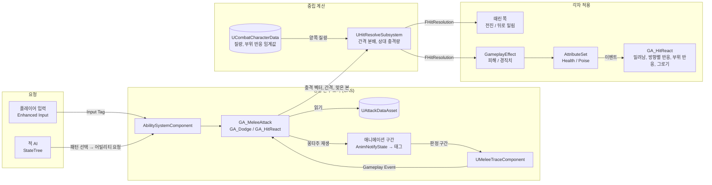

# 3인칭 격투 액션 포트폴리오 계획 (가칭: FirstAction)

> 대상 직무: Unreal Engine 클라이언트 리드 개발자
> https://www.iiccareers.com/ko/o/242685
> 자매 프로젝트: FirstVR (VR 슈팅, 컴포넌트 조합형 무기 시스템)

---

## 1. 공고와 포트폴리오의 연결

공고의 게임은 **콘솔/PC용 AAA 세미 오픈월드 어드벤처**이고, 담당 업무의 중심은 전투, 애니메이션, AI다.
포트폴리오의 모든 기능은 아래 표의 어느 한 칸을 증명하기 위해 존재한다. 표에 연결되지 않는 기능은 만들지 않는다.

| 공고 항목 | 포트폴리오에서 보여줄 것 |
|---|---|
| 플레이어 인터랙션, 스킬 시스템, 애니메이션 기반 조작감 | GAS 기반 공격/회피/스킬, 애니메이션 구간(입력 버퍼, 캔슬, 무적), 히트스톱, 모션 워핑 |
| NPC 및 적 AI 행동 로직, 전투 패턴 설계, 전투 시스템 고도화 | StateTree AI, 데이터 기반 패턴 선택, 공격 토큰(동시 공격 수 제어), 경직치 |
| 기획 의도를 빠르게 프로토타입으로 구현 | 새 공격, 새 적을 **C++ 추가 없이** 데이터와 에셋만으로 제작 |
| 기존 게임을 역기획해 기술 구현용 문서로 정리 | 데빌 메이 크라이의 타격 반응(밀려나는 적, 콤보 마무리 타격)을 역기획 → 기술 명세 → 실제 구현 |
| 기술 이슈 분석 및 해결 | 저 프레임 공격 판정 측정(10fps까지 누락 없음 → 서브스텝 보간은 근거가 생길 때까지 보류), Unreal Insights 측정 |
| 리드 경험, 개발 프로세스 개선 | 에셋 분리 구조, 데이터 검증, 기본/배포 두 가지 빌드 자동화 |

---

## 2. 핵심 설계 메시지

> **"플레이어와 적은 같은 전투 코어를 쓰고, 공격 하나는 데이터 한 장이다."**

1. **요청과 실행의 분리**: 플레이어 입력과 AI 판단은 모두 "이 어빌리티를 실행해 달라"는 요청만 보낸다. 어빌리티는 누가 요청했는지 모른다.
2. **공격은 데이터**: 몽타주, 피해, 경직치, 히트스톱, 콤보 분기, 모션 워핑 거리 등 공격의 모든 성질은 공격 데이터 에셋에 있다. 공격 어빌리티는 하나뿐이다.
3. **타이밍은 애니메이션, 의미는 태그**: "언제 맞는가, 언제 캔슬되는가"는 애니메이션 위의 노티파이 구간이 정하고, 코드는 그 구간이 켜는 게임플레이 태그의 의미만 안다.
4. **계산은 중립 매니저가 하고, 적용은 각자 한다**: 한 번의 타격으로 맞는 쪽뿐 아니라 때린 쪽도 움직인다. 그래서 양쪽 정보를 모두 보는 타격 해석 매니저가 결과를 계산하고, 각 캐릭터는 자기 몫의 결과만 자기 몸에 적용한다. (4.6)
5. **간격은 공격이 정하고, 나누는 비율은 질량이 정한다**: 타격 후 두 캐릭터 사이 간격은 공격 데이터에 있고, 그 간격을 누가 얼마나 만들지는 질량 비율로 정한다. (4.6)

FirstVR의 원칙(코어는 구체 타입을 모르고, 데이터가 흐름을 정한다)을 근접 전투로 옮긴 것이다. PDF에서 두 프로젝트를 같은 원칙의 두 가지 적용으로 묶어 보여줄 수 있다.

---

## 3. 게임 범위

### 3.1 플레이 한 사이클 (3~5분)

짧은 진입 통로(이동, 락온 연습) → 일반 적 그룹 전투 2회 → 엘리트 적 1체(패턴 3~4개) → 종료

### 3.2 플레이어

- 약 공격 / 강 공격 콤보 (콤보 분기 포함)
- 회피 (무적 구간, 공격 캔슬)
- 방어 3종: 가드 / 패리 / 저스트 회피. 모두 타격 해석 매니저의 규칙으로 구현한다 (4.6)
- 락온
- 스킬 1~2개 (예: 돌진기, 범위기)

### 3.3 폴리싱 우선순위

1. **공격** (최우선, 가장 깊게): 콤보 간격, 질량 분배, 히트스톱, 부위 반응, 마무리 타격
2. 방어 3종: 동작하고 구분되는 수준까지
3. 적 AI, 락온, 스킬

### 3.4 적

- **일반형**: 공격 토큰을 얻어야 공격, 토큰이 없으면 거리 유지와 측면 이동
- **엘리트형**: 거리별 패턴 선택, 예비 동작(텔레그래프), 경직치가 높아 그로기 유도가 목표

### 3.5 범위 밖

- 무기 교체, 인벤토리, 성장 시스템
- 오픈월드 스트리밍, 스토리 연출
- 멀티플레이 (네트워크 복제는 고려만 하고 구현하지 않음)
- 적이 플레이어 공격 예고를 보고 회피하는 반응 (템플릿의 `NotifyDanger` 흐름, `Docs/TemplateReview.md`)

---

## 4. 기술 구조

### 4.1 전체 구조



### 4.2 GAS 사용 범위

| 요소 | 내용 |
|---|---|
| ASC 위치 | 캐릭터에 직접 부착 (싱글플레이, 리스폰 시 어빌리티 상태는 이어지지 않고 초기화). Lyra처럼 PlayerState에 두는 방식과의 차이를 PDF에서 한 줄로 설명 |
| AttributeSet | `Health`, `MaxHealth`, `Poise`(경직치), `MaxPoise` (필요 시 `Stamina`) |
| 어빌리티 | `GA_MeleeAttack`(범용), `GA_Dodge`, `GA_HitReact`(이벤트로 발동), 방어 어빌리티 1종, 스킬 |
| 이펙트 | `GE_Damage`(SetByCaller로 피해/경직치 전달), 무적, 경직치 회복 |
| 태그 | `State.Attacking`, `State.Dodging`, `State.Invulnerable`, `State.Guarding`, `State.Staggered`, `Window.Combo`, `Window.Cancel`, `Window.Parry`, `Window.JustDodge`, `Event.Hit`, `InputTag.LightAttack` 등 |

### 4.3 공격 데이터 (`UAttackDataAsset : UPrimaryDataAsset`)

| 칸 | 의미 |
|---|---|
| `Montage` | 재생할 공격 몽타주 |
| `Damage` | 피해량 (SetByCaller로 전달) |
| `ImpactForce` | 충격 크기와 방향 (때린 쪽 기준 방향). 경직치 감소와 반응 단계는 이 값으로 계산된다 |
| `PostHitSpacing` | 타격 직후 두 캐릭터 사이에 남아야 할 간격. 콤보 중간 타격은 다음 공격이 닿는 거리, 마무리 타격은 크게 벌린다 |
| `HitStopDuration` | 맞았을 때 양쪽 캐릭터를 멈추는 시간 |
| `AttackBone` | 공격하는 팔의 기준 본 (예: `upperarm_r`). 패리 당했을 때 부위 반응을 주는 위치 |
| `MaxWarpDistance` | 공격 시작 시 모션 워핑으로 대상에게 붙는 최대 거리 |
| `ComboLinks` | `{입력 태그, 다음 공격 데이터}` 목록. 콤보 분기 정보는 여기에만 있다 |
| `CameraShake` | 피격 시 카메라 흔들림 |

### 4.4 애니메이션 구간

| 노티파이 스테이트 | 하는 일 |
|---|---|
| `ANS_TagWindow` (범용, 태그를 파라미터로 받음) | 구간 동안 ASC에 태그를 붙였다 뗀다. `Window.Combo`, `Window.Cancel`, `State.Invulnerable`을 모두 이 클래스 하나로 처리 |
| `ANS_HitWindow` | 구간 동안 지정한 소켓 쌍으로 판정 트레이스를 켠다 |
| `AN_Telegraph` | 적의 예비 동작 시점에 VFX/사운드/UI 신호 |

- **입력 버퍼**: 공격 중 들어온 입력을 짧은 시간(데이터값) 보관하고, `Window.Combo`가 열리는 순간 소비한다.
- C++에 프레임 번호나 초 단위 타이밍을 하드코딩하지 않는다.

### 4.5 피격 판정과 피해

- `UMeleeTraceComponent`: 이전 프레임과 현재 프레임의 소켓 위치 사이를 스윕한다. 처음에는 저 프레임 누락을 **서브스텝 보간**으로 해결할 계획이었으나, Step 5-6 측정에서 10fps까지 누락이 관찰되지 않아 보류했다. 휘두를 때마다 `판정 구간 끝: 스윕 N프레임, 맞힘 M` 진단 로그를 남기고, Hit Window를 줄이거나 빠른 공격을 추가할 때(6-15) 다시 측정한다.
- 한 번의 휘두름에서 같은 대상은 한 번만 맞는다.
- 판정 → `Event.Hit` 게임플레이 이벤트 → 공격 어빌리티가 타격 정보를 타격 해석 매니저에 넘긴다 (4.6) → 결과로 대상에게 `GE_Damage` 적용 → 대상 AttributeSet의 `PostGameplayEffectExecute`에서 경직치 감소, 0이면 그로기 이벤트.
- 히트스톱: 양쪽 액터의 `CustomTimeDilation`을 데이터 시간만큼 낮춘다.

### 4.6 타격 해석과 피격 반응 (역기획: 데빌 메이 크라이)

**레퍼런스에서 가져온 것**: 플레이어의 공격에 적이 적절히 밀려나고, 콤보 마무리 타격은 적을 화끈하게 밀어낸다.

**설계 결론**

1. **간격은 공격이 정한다.** 콤보 중간 타격마다 크게 밀려나면 적이 다음 공격 범위를 벗어나 콤보가 끊긴다. 그래서 타격 후 간격(`PostHitSpacing`)을 공격 데이터가 가진다.
2. **간격을 누가 얼마나 만들지는 질량 비율이 정한다.** 어느 경우든 타격 후 간격은 같다.
   - 작은 적: 적이 크게 밀려나고, 플레이어는 앞으로 붙는다 (모션 워핑)
   - 큰 적: 적은 조금만 밀려나고, 플레이어가 뒤로 밀린다
3. **계산은 중립 매니저가 한다.** `UHitResolveSubsystem : UWorldSubsystem`이 양쪽 정보를 받아 결과를 계산하고, 각 캐릭터는 자기 몫만 적용한다.
4. **부위 반응은 임계값 이상일 때만 준다.** 모든 타격에 주면 적이 가벼워 보인다. 적 크기 대비 충격이 임계값 이상일 때만 맞은 본 아래에 물리 반응을 준다. (FirstVR의 물리 피격 반응 방식 재사용)

**매니저 입력**

| 정보 | 출처 |
|---|---|
| 충격 벡터 (방향, 크기) | 공격 데이터 `ImpactForce` |
| 타격 후 간격 | 공격 데이터 `PostHitSpacing` |
| 질량 (때린 쪽, 맞는 쪽 모두) | 공통 캐릭터 데이터 `UCombatCharacterData` |
| 맞은 본, 피격 위치 | 판정 결과 |

**매니저 출력 (`FHitResolution`)**

| 결과 | 쓰는 곳 |
|---|---|
| 때린 쪽 이동량 (전진 또는 뒤로 밀림) | 때린 쪽 캐릭터 |
| 맞는 쪽 이동량 | 맞는 쪽 캐릭터 (반응이 막혀도 밀린다, 6-7 결정) |
| 상대 충격량 (충격 ÷ 맞는 쪽 질량) | 경직치 감소량, 반응 단계, 부위 반응 여부 |
| 맞은 본, 방향 | 방향별 반응 몽타주, 부위 반응 |

- 상대 충격량은 매니저가 **한 번만** 계산해서 넘긴다. 받는 쪽마다 따로 나누면 같은 계산이 여러 곳에 흩어진다.
- 질량 비율 분배 공식과 상대 충격량 → 경직치 변환식은 Step 6에서 수치를 보며 정한다.

**공통 캐릭터 데이터 (`UCombatCharacterData`)**

- `Mass`: 플레이어와 적 모두 가진다
- 부위 반응의 부위 대표 본 목록과 회복 시간 (6-8). 부위 반응 임계값·세기는 세계 규칙이라 프로젝트 설정 `Combat`에 둔다 (6-8 결정)
- 반응 단계별 몽타주 (움찔·경직은 머리/몸통). 단계 기준값은 세계 규칙이라 프로젝트 설정 `Combat`에 둔다 (6-7 결정)

**피격 반응 단계**

- 상대 충격량으로 반응 단계 결정 (움찔 / 경직 / 넘어짐), 경직치가 0이 되면 그로기 (6-7)
- 깃 버전은 앞쪽 피격 애니메이션만 있어 머리/몸통만 구분하고, 방향은 부위 물리 반응(6-8)이 보여 준다
- 임계값 이상이면 맞은 본 아래에 물리 반응을 블렌딩 (`PhysicalAnimationComponent` 또는 본 아래 물리 블렌드)

**방어 규칙**

방어는 별도 시스템이 아니다. 매니저가 **맞는 쪽 상태 태그**를 보고 `FHitResolution`을 바꾸는 규칙이다.

| 방어 | 판단 태그 | 간격 이동 | 피해 | 상대 충격량 | 결과 |
|---|---|---|---|---|---|
| 가드 | `State.Guarding` | 일반 타격과 같음 (연속 공격을 계속 받아내도록) | 없음 또는 감소 | 방어자 | 밀리면서 버틴다 |
| 패리 | `Window.Parry` | 양쪽 모두 없음 | 없음 | **공격자에게 반대 방향으로 되돌림** | 공격자의 `AttackBone` 아래 부위 반응 + 튕겨 나가는 애니메이션 + 경직. 방어자가 먼저 공격할 기회를 얻는다 |
| 저스트 회피 | `Window.JustDodge` | 공격자는 공격 데이터대로, 방어자는 회피 방향으로 | 없음 | 없음 | 위치를 빼고 다음 행동 준비 |

- 패리는 새 기능 없이 충격 벡터 반전 + 부위 반응 + 경직 태그를 재사용한다.
- 패리로 생긴 경직 태그는 적 AI와 공격 토큰이 보고 공격을 멈추는 기준이 된다.
- 구간 위치 (6-10 결정): `Window.Parry`는 가드 시작 몽타주 앞부분(가드를 올리는 순간), `Window.JustDodge`는 회피 몽타주 무적 구간의 앞부분. 겹치면 좁은 창이 이긴다(패리 > 가드, 저스트 회피 > 일반 회피). 가드·패리는 맞는 쪽 정면 각도 안에서만 성립하고, 연타 패리는 가드 내리기 동작으로 막는다.

### 4.7 적 AI

- **StateTree** (제안. Behavior Tree와 비교는 9장 결정 목록)
  - `Idle` → `Engage` → { `Approach` / `Strafe` / `Attack` / `Recover` } → `Staggered` → `Dead`
- **패턴 데이터** (`UEnemyPatternDataAsset`): `{공격 데이터, 최소/최대 거리, 쿨다운, 가중치, 토큰 필요 여부}` 목록
- **공격 토큰** (`UCombatTokenSubsystem : UWorldSubsystem`): 동시에 공격할 수 있는 적 수를 한 곳에서 제어. 공격 종료, 피격, 사망 시 반납.
- AI는 패턴을 **선택**만 하고, 실행은 플레이어와 같은 `GA_MeleeAttack`이 한다.

### 4.8 카메라와 락온

- `ULockOnComponent`: 화면 중앙 가중치 기반 대상 선택, 대상 전환, 거리 이탈 시 해제
- 락온 시 카메라 보간, 공격 시 모션 워핑 대상으로 사용

---

## 5. 에셋 정책: 깃에는 기본 에셋, 배포 빌드에는 유료 에셋

### 5.1 폴더

```
Content/
├── Portfolio/        # (git) 직접 만든 블루프린트, 데이터, 레벨, 기본 세트
├── Characters/       # (git) 템플릿 기본 마네킹
├── Portfolio/Animations/Quaternius/  # (git) CC0 원본 임포트와 IK Rig/Retargeter (5.3 참고)
├── Portfolio/Animations/Retargeted/  # (git) 마네킹으로 리타깃한 결과
└── ThirdParty/       # (git 제외) Fab 유료 원본 + 이를 참조하는 몽타주, Release 세트
```

### 5.2 규칙

1. **`Portfolio/` → `ThirdParty/` 하드 참조 금지.** 깃을 클론한 사람이 바로 열고 실행할 수 있어야 한다.
2. **모든 애니메이션은 UE5 마네킹 스켈레톤 기준.** 유료 애니메이션은 IK Retargeter로 마네킹에 리타깃해 `ThirdParty/`에 저장한다.
3. **소켓과 노티파이 이름 규약을 공유**한다. 유료 애니메이션에도 같은 이름의 노티파이 구간을 찍는다.
4. **콘텐츠 세트** (`UCombatContentSet : UPrimaryDataAsset`): 캐릭터 메시, 애니메이션 블루프린트, 공격 데이터 목록, 적 구성.
   - `Default` 세트: `Portfolio/Data/` (git)
   - `Release` 세트: `ThirdParty/Data/` (git 제외)
5. **선택과 폴백**: `UPortfolioContentSettings : UDeveloperSettings`에 `Release` 세트를 소프트 참조로 지정한다. 로드에 실패하면 `Default`로 폴백하고 로그를 남긴다.
6. **쿡 포함 보장**: Asset Manager에 `CombatContentSet` 기본 에셋 타입을 등록해 Release 세트가 패키지에 들어가게 한다.
7. `.gitignore`에 `Content/ThirdParty/` 추가. 커밋 전 Reference Viewer 또는 데이터 검증으로 규칙 1 확인.

> 유니티 대응: Asset Manager의 기본 에셋 ≈ Addressables 그룹/라벨, `TSoftObjectPtr` ≈ `AssetReference`. 폴백 구조는 Addressables에서 원격 카탈로그 실패 시 로컬로 돌아가는 구조와 같은 발상이다.

### 5.3 기본 에셋 버전의 애니메이션

- UE 5.6부터 Third Person 템플릿에 **Combat 변형(Variant)**이 있고, 맨손 전투, 대상 지정, 체력 시스템이 포함되어 있다.
- 이 변형으로 **참고용 프로젝트를 따로 만들고**(저장소에 넣지 않음), 거기서 공격/피격 애니메이션만 메인 프로젝트로 가져와 기본 세트에 쓴다.
- **결정 (2026-11-15)**: 깃 버전 검 애니메이션은 **Quaternius UAL2 Standard**(무료, CC0)의 루트 모션 버전(`UAL2_Standard_RM.glb`)을 쓴다. Combat 변형 프로젝트는 비교 분석용으로만 남긴다. 검 메시 후보는 LowPoly Medieval Weapons(CC0).
  - 확인된 검/근접 동작: `Sword_Regular_A/B/C`(+ 각 `_Rec`), `Sword_Regular_Combo`, `Sword_Heavy_Combo`, `Sword_Block`, `Sword_Dash`, `Hit_Knockback`, `Melee_Hook`(+ `_Rec`), `Shield_Dash`, `Shield_OneShot`
  - **빈 곳**: 회피(구르기, 스텝), 방향별 피격 반응
  - 스켈레톤은 UE4 마네킹 본 이름 규칙(`root`, `pelvis`, `spine_01~03`)이며 T 포즈. 자동 생성 IK Retargeter로 UE5 Manny에 리타깃되고 루트 모션도 유지됨을 0-5에서 확인했다.
  - 임포트: Interchange glTF, 스켈레톤 None(새로 생성). 제작자 안내(`Unreal_Setup.png`)는 `Use 30Hz to Bake Bone Animation`, `Snap to Closest Frame Boundary`를 켜라고 한다.
- Fab 에셋은 무료라도 Standard License라 깃에 넣을 수 없다. Mixamo도 원본 재배포 금지라 깃 제외. 둘 다 배포 빌드에는 쓸 수 있다.
- 배포 빌드 후보: Fab의 UE5 마네킹 기반 검 애니메이션 팩 (예: GameDevHero One Handed Sword V2, Sword and Shield V1, Great Sword V1). 가격과 라이선스는 구매 전 확인.
- ⚠️ 템플릿에 전투가 이미 있으므로, 평가자가 "템플릿 전투를 그대로 쓴 것"으로 볼 위험이 있다. 로직은 템플릿 코드를 쓰지 않고 새로 설계하며, PDF에 **"템플릿 Combat 변형과 무엇이 다른가"** 비교 페이지를 둔다.

### 5.4 라이선스

- Fab 에셋 원본은 재배포가 제한될 수 있으므로 깃에서 제외한다.
- 패키징된 배포 빌드 공개, 영상과 스크린샷 사용이 각 에셋 라이선스상 허용되는지 구매 전에 확인한다.

---

## 6. 개발 환경

- **UE 5.6 이상** (Combat 변형 필요). FirstVR과 같은 버전을 쓰면 엔진 설치를 공유할 수 있다.
- 메인 프로젝트: Third Person, **C++**, 변형 **None**
- 참고 프로젝트: Third Person, Combat 변형 (저장소 X)
- 플러그인: Gameplay Abilities, Motion Warping, StateTree, Gameplay StateTree, Enhanced Input
- IDE: Visual Studio 2022 또는 Rider
- **게임패드 권장**: 조작감 튜닝은 패드 기준으로 한다.
- Git LFS: `*.uasset`, `*.umap`

---

## 7. 작업 목록

### Phase 0. 준비
- [ ] 메인/참고 프로젝트 생성, 플러그인 활성화
- [x] Git 저장소, LFS, `.gitignore`(`Content/ThirdParty/` 포함)
- [x] Quaternius UAL2 무료 버전에 검 콤보, 피격 애니메이션이 있는지 확인 → 검 콤보, 강공격, 가드 있음. 회피와 방향별 피격 없음 (5.3)
- [ ] **리타깃 검증**: UAL2 애니메이션 하나, Fab 후보 하나를 마네킹에 리타깃해 재생 확인 (가장 큰 리스크를 먼저 확인) → UAL2, UAL1 완료. Fab 후보는 유료 에셋 선정 시점(커리큘럼 9-3)으로 이연
- [ ] 유료 에셋 후보 목록과 라이선스 확인
- [x] 역기획할 레퍼런스 게임과 요소 결정 → 데빌 메이 크라이, 타격 반응과 간격

### Phase 1. 설계와 역기획
- [ ] 역기획 문서 (`Docs/ReverseDesign.md`): 4.6의 결론을 레퍼런스 관찰 → 규칙 → 기술 명세 순서로 정리
- [ ] 9장 결정 목록 확정
- [ ] 클래스 구조도, 태그 목록, 데이터 구조표 초안

### Phase 2. 플레이어 전투 코어 (최우선)
- [ ] GAS 뼈대: 캐릭터 기반 클래스, ASC, AttributeSet, 네이티브 태그
- [ ] 입력 태그 → 어빌리티 활성화
- [ ] `UAttackDataAsset`, `GA_MeleeAttack`, 몽타주 재생
- [ ] `ANS_TagWindow`, 입력 버퍼, 콤보 분기
- [ ] `UMeleeTraceComponent`, `GE_Damage`, 훈련용 더미
- ✅ 마일스톤: 약-약-강 콤보로 더미의 체력과 경직치가 줄어든다

### Phase 3. 조작감
- [ ] 히트스톱, 카메라 흔들림
- [ ] 모션 워핑
- [ ] `UCombatCharacterData`, `UHitResolveSubsystem`: 간격 분배와 상대 충격량
- [ ] 작은 적 / 큰 적 더미로 타격 후 간격이 같게 유지되는지 확인
- [ ] 방향별 피격 반응, 경직치와 그로기
- [ ] 임계값 기반 부위 반응
- [ ] 회피(무적, 캔슬)
- [ ] 방어 3종: 가드, 패리, 저스트 회피 (매니저 규칙)
- [ ] 락온
- [ ] **공격 폴리싱** (최우선): 튜닝값 기록 (입력 버퍼, 캔슬 시점, 히트스톱, 간격, 부위 반응 임계값의 전후 비교)
- ✅ 마일스톤: 패드로 더미를 상대할 때 공격의 "손맛"이 있고, 방어 3종이 서로 구분된다

### Phase 4. 적 AI
- [ ] 적 캐릭터 (같은 기반 클래스, 같은 어빌리티)
- [ ] StateTree: 접근, 측면 이동, 공격, 회복, 경직, 사망
- [ ] 패턴 데이터 기반 공격 선택
- [ ] 공격 토큰 서브시스템
- ✅ 마일스톤: 일반 적 4체 중 정해진 수만 동시에 공격한다

### Phase 5. 확장성 증명과 콘텐츠
- [x] 엘리트 적: 새 패턴 데이터와 공격 데이터만으로 제작 (C++ 추가 0줄. 같은 스텝의 점프 수정은 템플릿 입력 문제로 엘리트와 무관)
- [ ] 플레이어 새 공격 1개를 데이터만으로 추가하는 과정 기록
- [ ] 데이터 검증 (`IsDataValid`): 몽타주 누락, 판정 구간 없는 공격 등
- [ ] 짧은 플레이 레벨 구성

### Phase 6. 배포 빌드
- [ ] `UCombatContentSet`, `UPortfolioContentSettings`, 폴백
- [ ] Asset Manager 등록, 유료 에셋 Release 세트 구성
- [ ] 빌드 스크립트 (RunUAT BuildCookRun): 기본 빌드 / 배포 빌드
- [ ] Unreal Insights로 적 다수 전투 측정

### Phase 7. PDF
- [ ] 8장 구성대로 제작

---

## 8. PDF 구성 (링크 없이도 혼자 설득할 수 있어야 한다)

1. 기획 의도와 공고 연결 (1장 표)
2. 역기획 문서 요약: 데빌 메이 크라이 타격 반응 관찰 → 간격/질량 규칙 → 기술 명세 → 구현 결과 (작은 적과 큰 적의 같은 콤보 비교 스크린샷)
3. 전투 코어 구조도: 플레이어와 AI가 같은 코어를 쓰는 구조
4. 공격 데이터 한 장 + 노티파이 트랙 스크린샷
5. 콤보 그래프 표
6. 적 패턴 표, StateTree 스크린샷, 공격 토큰
7. 조작감 튜닝값 (전후 비교)
8. 확장성: 새 공격과 엘리트 적, **추가된 C++ 0줄**
9. 방어 3종 = 매니저 규칙 3개: 같은 타격이 상태 태그에 따라 다른 결과가 되는 표와 스크린샷
10. 템플릿 Combat 변형과의 비교
11. 에셋 분리와 빌드 파이프라인 (리드 역량)
12. 기술 이슈 분석: 저 프레임 판정 측정과 보류 판단(측정 근거 없이 코드를 넣지 않음), 성능 측정
13. 배포 빌드 스크린샷 (유료 에셋 적용)
14. 보조 자료: 영상, 깃허브

---

## 9. 결정 필요 목록

튜토리얼 진행 중 질문으로 하나씩 결정하고, 결정되면 이 표를 갱신한다.

| 항목 | 선택지 | 상태 |
|---|---|---|
| 역기획 레퍼런스 | 게임과 요소 | **결정**: 데빌 메이 크라이의 타격 반응과 간격 (4.6) |
| 타격 후 간격 | 공격 / 맞는 쪽 | **결정**: 공격 데이터가 간격을 가지고, 질량 비율로 나눈다 |
| 간격 계산 위치 | 때린 쪽 / 맞는 쪽 / 외부 | **결정**: 외부 매니저 (`UHitResolveSubsystem`) |
| 부위 반응 | 항상 / 조건부 | **결정**: 상대 충격량이 임계값 이상일 때만 |
| 상대 충격량 계산 | 매니저 / 받는 쪽 각자 | 제안: 매니저가 한 번 |
| 전투 형태 | 맨손 격투 / 근접 무기 | **결정**: 근접 무기(검). 공격이 닿는 거리가 길어 타격 후 간격과 질량에 따른 분배가 더 분명하게 보인다 |
| 깃 버전 애니메이션 출처 | 템플릿 Combat 변형 / Quaternius(CC0) | **결정**: Quaternius UAL2 Standard 루트 모션 버전. 회피와 방향별 피격은 무료 범위에 없어 별도 결정 (5.3) |
| 깃 버전 회피·피격의 표현 수준 | 규칙 동작 확인 / 보기에도 자연스러움 | **결정 변경 (2026-11-15)**: ~~보기에도 자연스러워야 한다~~ → **규칙 동작 확인 수준**. Uthana 시험에서 스켈레톤 축척과 루트 본 문제로 시간이 과하게 들어 중단. 깃 버전은 이미 있는 UAL1/UAL2 동작으로 기능을 보여 주고, 자연스러운 동작은 배포 빌드(유료 에셋)와 영상에서 보여 준다 |
| 회피·피격과 공격의 동작 질감 통일 | 통일 / 달라도 됨 | **결정**: 달라도 된다. 후보는 Quaternius UAL1(CC0, 무료판: 구르기, 머리·가슴 피격 / Pro $9.99: 좌우 회피, 어깨·배 피격 추가)과 Uthana(AI 생성, 무료는 출처 표기 조건 상업 사용). GASP/Lyra(Fab Standard License), DeepMotion, Plask, Cascadeur 무료판은 공개 저장소 불가 |
| 깃 기본 세트 애니메이션 비용 | 유료 허용 / 무료로만 | **결정**: 무료로만. UAL1 무료판(구르기, 머리·가슴 피격) + UAL2(`Hit_Knockback`). 좌우 회피는 구르기를 입력 방향으로 돌려 쓰고, 방향별 피격은 부위 물리 반응(6-8)으로 구분한다. Uthana는 쓰지 않음 |
| 방어 수단 | 가드 / 패리 / 저스트 회피 | **결정**: 셋 다 구현 (매니저 규칙, 4.6). 폴리싱은 공격 최우선 (3.3) |
| AI 구조 (7-2) | StateTree / Behavior Tree | **결정 (2026-11-18)**: StateTree. 적은 "지금 어느 상태인가"(접근, 맴돌기, 공격, 회복, 경직, 사망)를 들고 있고 조건이 맞을 때만 옮긴다(맴돌기 방향·시간 같은 상태별 데이터 유지, 경직이 끝나면 정해진 상태로 복귀). StateTree는 이를 틀 자체로 표현하고, 템플릿 `CombatAIController`와 이동·보조 태스크를 고쳐 쓸 수 있다. Behavior Tree는 Blackboard enum과 Observer Abort로 상태 머신을 흉내 내야 한다 |
| AI가 몸 상태를 아는 방법 (7-3) | 조건(ASC 태그) / StateTree 이벤트 | **결정 (2026-11-18)**: 조건으로 본다. 전이 조건이 적 ASC의 상태 태그(`State.Staggered`, `State.Dead` 등)를 확인한다. 토큰 관리자(7-2)와 같은 출처 |
| 적 AI 대상 (7-3) | 플레이어 직접 / AI Perception | **결정 (2026-11-18)**: AI Perception 시각 감지로 "보인 적"(팀 태도 Hostile)을 대상으로 잡는다. 시야 거리·각도가 생기고 등 뒤는 보지 못한다 |
| 대상을 놓는 시점 (7-3) | 놓지 않음 / 안 보이면 일정 시간 뒤 | **결정 (2026-11-18)**: 보지도 맞지도 않은 채 기억 시간(`TargetMemoryTime`)이 지나면 놓고 Idle로 |
| 시야 밖 대상에 돌아서는 계기 (7-3) | 반응 시간 / 맞으면 즉시 / 둘 다 | **결정 (2026-11-18)**: 둘 다. 시야에서 사라지면 반응 시간(`ReactionTime`, 적마다) 동안 마지막으로 본 위치를 보고, 지나면 돌아선다. 맞으면 Damage 감각(`ReportDamageEvent`, 캐릭터가 `Event.HitReact`에서 보고)으로 즉시 돈다. 등 뒤로 돌아가기의 가치가 반응 시간으로 정해진다 |
| 돌아선 뒤 보는 곳 (7-3) | 마지막으로 본 위치 / 대상의 지금 위치 / 가까울 때만 지금 위치 | **결정 (2026-11-18)**: 근접 감지 거리(`ProximityAwarenessRadius`, 몸 간격) 안이면 대상의 지금 위치를 알고(기억도 새로 셈), 밖이면 마지막으로 안 위치만 안다. 몸을 맞댄 근접전에서는 결국 찾아내고, 멀리 빠져나가면 따돌릴 수 있다. 엔진 `AutoSuccessRangeFromLastSeenLocation`은 반응 시간을 없애므로 쓰지 않는다 |
| AI 성향 값의 위치 (7-3) | 패턴 데이터 / 캐릭터 데이터 / 별도 데이터 | **결정 (2026-11-18)**: `UEnemyPatternDataAsset` 한 장에 인지·반응 값과 패턴 목록(7-4)을 함께 둔다. 적 종류 하나 = 패턴 데이터 한 장(Step 8-1 엘리트) |
| 경직 중 공격 토큰 (7-2) | 반납 / 유지. 반납 주체 AI / 토큰 관리자 | **결정 (2026-11-18)**: 경직되는 순간 반납해 다른 적이 들어온다. 반납은 `UCombatTokenSubsystem`이 토큰 보유자의 상태 태그를 보고 한다(AI는 반납을 모른다, 규칙 8). 경직이 풀린 적은 토큰부터 다시 얻어야 공격한다 |
| 경직 상태로 보는 태그 (7-3) | 경직 이상만 / 움찔 포함 | **결정 (2026-11-19)**: `State.Staggered`, `State.Downed`, `State.Groggy` 묶음. 움찔(`State.Flinching`)은 공격을 끊지 않는 가벼운 반응이라 AI도 하던 일을 계속한다 |
| 유틸리티 AI 적용 범위 (7-3) | 상태 선택 전체 / 패턴 선택에만 / 쓰지 않음 | **결정 (2026-11-19)**: 7-4 패턴 선택 태스크 안에서만 점수로 고른다. 상태 흐름(접근 → 맴돌기 → 공격 → 회복, 경직, 사망)은 StateTree 전이로 둔다 |
| 맴돌기 방식 (7-3) | 제자리 대기 / 대상 둘레 옆걸음 / EQS 측면 지점 이동 | **결정 (2026-11-19)**: 대상을 바라본 채 맴돌 거리(`StrafeDistance`)를 유지하며 옆걸음으로 돈다. 방향과 시간은 시작할 때 고른다 |
| 맴돌다 막힐 때 (7-3) | 그냥 밀림 / 막히면 방향 전환 / 막히기 전에 방향 전환 | **결정 (2026-11-19)**: 도는 방향 앞을 구(`StrafeBlockCheckDistance`)로 검사해 다른 캐릭터나 벽이 있으면 막히기 전에 방향을 바꾼다 |
| 공격 시작 거리 (7-3) | 맴돌 거리에서 바로 / 걸어 들어간 뒤 | **결정 (2026-11-19)**: 그 공격의 `MaxWarpDistance` 안까지 걸어 들어간 뒤 공격을 요청하고, 나머지는 워핑이 메운다 |
| 패턴 하나의 모양 (7-4) | 공격 데이터 한 장 / 시작 공격 + 입력 태그 순서 / 공격 데이터 목록 | **결정 (2026-11-19)**: 시작 공격 + 이어 갈 입력 태그 순서. 다음 공격은 `ComboLinks`가 정하고(규칙 4), 적은 플레이어와 같은 `AbilityInputTagPressed` 통로로 입력만 보낸다(규칙 1) |
| 적 콤보 입력 시점 (7-4) | 구간이 열리자마자 / 무작위 지연 | **결정 (2026-11-19)**: 콤보 구간이 열린 뒤 무작위 지연 뒤에 보낸다. 지연 범위는 적마다 패턴 데이터(`ComboInputDelayMin/Max`). 지연보다 구간이 먼저 닫히면 콤보를 놓친다 |
| 콤보를 이어 가는 조건 (7-4) | 항상 / 맞거나 막혔을 때만 | **결정 (2026-11-19)**: 적마다 패턴 데이터(`ComboContinueRule`). 일반형 `Always`, 엘리트 `OnHitOrGuard`(헛치면 멈춤). 닿았는지는 공격 어빌리티가 올리는 캐릭터의 `AttackConnectCount`로 본다 |
| 패턴 점수 재료 (7-4) | 가중치만 / 가중치 × 거리 × 반복 방지 / + 대상 상태 | **결정 (2026-11-19)**: 가중치 × 거리(몸 간격이 `MinGap`~`MaxGap` 안이면 1) × 반복 방지(쓴 직후 0에서 `RepeatCooldown`에 걸쳐 1로). 모두 0이면 거리, 그다음 반복 방지를 빼고 다시 센다. 대상 상태 점수는 배포 빌드에서 |
| 패턴 고르는 방법 (7-4) | 최고점 / 점수 비례 무작위 | **결정 (2026-11-19)**: 점수에 비례해 무작위로 고른다 |
| 공격 토큰 묶음 (7-5) | 세계 전체 N개 / 공격 대상마다 N개 | **결정 (2026-11-19)**: 공격받는 대상마다 따로 둔다. "몇 명에게 동시에 맞을 수 있나"는 맞는 쪽의 성질 |
| 대상의 토큰 수 위치 (7-5) | 캐릭터 데이터 / 캐릭터 BP 기본값 / 프로젝트 설정 | **결정 (2026-11-19)**: `UCombatCharacterData::AttackTokens`. 플레이어 2 |
| 토큰을 쥐는 구간 (7-5) | 걸어 들어가기 ~ 공격 끝 / ~ 회복 끝 / 휘두르는 동안만 | **결정 (2026-11-19)**: 걸어 들어가기 시작 ~ 회복 끝. 공격 사이에 숨 돌릴 틈이 생긴다. 공격 상태가 실패하거나 끊겨도 돌려주고, 경직·사망은 관리자가 회수(7-2) |
| 토큰을 받는 순서 (7-5) | 먼저 요청 / 오래 기다린 순 / 대상 기준 점수 | **결정 (2026-11-19)**: 대상에게 가깝고 대상 시선(`GetViewRotation`, 플레이어는 카메라) 정면인 적부터. 비용 = 몸 간격 + 각도 × `AttackTokenAnglePenalty`(프로젝트 설정, 3 cm/도). 맴돌기 시간이 끝난 적만 기다리는 적으로 세고, 1등에게 맞는 토큰이 모자라면 아무도 받지 않는다 |
| 패턴 토큰 비용 (7-5) | 모두 1 / 패턴마다 비용 / 필요 여부 | **결정 (2026-11-19)**: 패턴마다 `TokenCost`(토큰 = 위협 예산). 남은 토큰보다 비싼 패턴은 그 순간 후보에서 빠진다. 깃 버전 `Heavy` 2, 나머지 1 |
| 엘리트를 엘리트답게 만드는 축 (8-1) | 행동만 / 행동 + 몸 / 행동 + 몸 + 새 공격 | **결정 (2026-11-19)**: 셋 다. 패턴 데이터(행동), 캐릭터 데이터와 초기 속성 GE(몸), 공격 데이터와 몽타주(돌진 베기) 각 한 장. C++ 변경 0줄 |
| 엘리트를 끊는 방법 (8-1) | 140kg 강공격부터 / 200kg 콤보 마무리만 / 300kg 일반 공격 불가 | **결정 (2026-11-19)**: 질량 200kg. 약·강공격에는 공격 중 움찔(슈퍼아머), 약-약-약 마무리(상대 충격량 320)에서만 경직. 패리와 그로기는 언제나 통한다 |
| 엘리트 내구도 (8-1) | 200/100 / 300/100 / 300/150 | **결정 (2026-11-19)**: 체력 300, 경직치 100(`GE_InitAttributes_Elite`). 그로기를 한두 번 보고 끝나는 싸움 |
| 엘리트 전용 공격의 역할 (8-1) | 단독 돌진 / 콤보 시작기 / 콤보 마무리 | **결정 (2026-11-19)**: 콤보 시작기. `DA_Attack_Elite_Dash`(워핑 최대 450)의 `ComboLinks`로 돌진 → Light_02 → Light_03. 패턴 `DashCombo`(거리 250~600, 토큰 2). 헛치면 `OnHitOrGuard`로 멈춘다 |
| 점프 입력 경로 (8-1 중 발견) | 템플릿 직접 바인딩 유지 / 어빌리티 `GA_Jump` | **결정 (2026-11-19)**: `GA_Jump`(`InputTag.Jump`). 템플릿은 `ACharacter::Jump`에 바로 묶어 공격 중에도 뛰었다(규칙 1 위반). 시작 규칙은 회피와 같다: 경직·사망 중 불가, 공격·회피·움찔·가드 중엔 캔슬 구간에서만, 시작하면 행동 몽타주를 멈춘다 |
| 공중 규칙 (8-1 중 발견) | 모두 막기 / 공중 공격 허용 | **결정 (2026-11-19)**: 공중에서는 공격·회피·가드·점프 모두 막는다. 캐릭터가 낙하 이동 모드에 `State.InAir`를 붙이고(걸어서 떨어질 때도 같은 규칙), 착지하는 순간 버퍼 입력을 다시 시도한다 |
| 맞은 쪽 히트스톱 적용 주체 (6-1) | 공격 어빌리티가 양쪽에 / 맞은 쪽이 스스로 | **결정 (2026-11-16)**: 맞은 쪽이 스스로 건다. 공격 어빌리티는 자기 캐릭터에만 걸고, 맞은 쪽에는 게임플레이 이벤트로 멈춤 시간을 넘긴다(규칙 6의 "적용은 각자"). 6-4 이후에는 매니저가 정한 값이 같은 통로로 흐른다 |
| 타격 연출(카메라 흔들림, 타격음, 불꽃) 통로 (6-1) | 템플릿 방식(`BlueprintImplementableEvent`) / GameplayCue | **결정 (2026-11-16)**: GameplayCue. 게임 코드(어빌리티, 캐릭터)는 연출을 모르고, 연출 추가는 Cue 에셋 수정만으로 한다. 타격음과 불꽃도 같은 Cue에 붙인다. 히트스톱은 게임 규칙(애니메이션·노티파이 타이밍)에 영향을 주므로 Cue가 아니라 이벤트 경로 |
| 간격 분배 공식의 모양 (6-4) | 질량 비율로 Δ 분할 / 맞은 쪽 먼저, 때린 쪽이 나머지 | **결정 (2026-11-16)**: 맞은 쪽 밀림 거리 d_v를 상대 충격량(충격 ÷ 맞은 쪽 질량)으로 먼저 정하고, 때린 쪽 d_a = (PostHitSpacing − 맞은 순간 간격) − d_v. 작은 적은 d_v가 커서 d_a < 0(전진), 큰 적은 d_v가 작아 d_a > 0(뒤로 밀림). 질량 비율로 Δ만 나누면 때린 쪽이 전진할 수 없다. 계수는 6-6에서 튜닝 |
| 상대 충격량 → 밀림 거리 변환과 계수 위치 (6-4) | 비례 / 시간 / 감속. 공격 데이터 / 캐릭터 데이터 / 프로젝트 설정 | **결정 (2026-11-16)**: 단순 비례(d_v = k × 상대 충격량). 계수는 특정 공격·캐릭터가 아닌 "세계 규칙"이므로 프로젝트 설정(`UDeveloperSettings`)에 둔다. 상대 충격량 → 경직치 감소량 계수도 같은 곳에 둔다 |
| `FHitResolution` 전달 통로 (6-4) | 전용 타깃 데이터 / 매니저에 다시 질의 / UObject 포장 | **결정 (2026-11-16)**: `FGameplayAbilityTargetData`를 상속한 전용 타깃 데이터에 담아 `Event.HitReact`의 `TargetData`로 보낸다. 매니저는 상태를 기억하지 않고(계산만), 결과는 이벤트와 함께 맞은 쪽으로 간다(규칙 6). 6-5 밀림, 6-7 반응, 6-8 부위 반응이 같은 데이터를 읽는다 |
| 한 몽타주 안 여러 타격의 워핑 대상 (6-6에서 발견) | Motion Warping 구간 시작마다 재질의 / 휘두름마다 공격 데이터 분리 | **결정 (2026-11-17)**: 구간이 시작될 때마다 대상을 다시 묻는다. 6-2의 "타마다"를 몽타주 시작으로 구현해 `Heavy_Combo`(구간 4개)의 2타부터 1타 시점의 낡은 목표로 워핑되어 제자리 공격이 되었다. `UMotionWarpingComponent::OnPreUpdate`(새 구간의 수정자가 생긴 직후, 활성화 직전에 불림)에서 처음 보는 `AttackTarget` 구간이면 `UpdateWarpTarget`. 휘두름마다 다른 간격·충격은 6-15에서 필요하면 데이터 분리로 다룬다 |
| 맞은 쪽 히트스톱·밀림 적용 주체 (6-7) | 캐릭터 / `GA_HitReact` | **결정 (2026-11-17)**: 캐릭터에 둔다(4.6 출력 표의 "맞는 쪽 `GA_HitReact`"를 변경). 밀림과 히트스톱은 몸에 생기는 물리 결과라 반응이 막혀도(가드, 그로기, 누움) 적용되어야 한다. `GA_HitReact`는 반응 몽타주와 상태 태그만 맡는다 |
| 피격 반응이 맞은 쪽 공격을 끊는 기준 (6-7) | 항상 / 반응 단계(질량) / 공격 구간 태그(슈퍼아머) | **결정 (2026-11-17)**: 질량에 맡긴다. 움찔은 공격을 끊지 않고, 경직 이상은 반응 몽타주가 공격 몽타주를 끊는다. 큰 적은 상대 충격량이 작아 움찔에 머물러 슈퍼아머가 질량에서 저절로 생긴다. 별도 슈퍼아머 구간은 만들지 않는다 |
| 공격 중 움찔의 표현 (6-7) | 몽타주 없음 / 상체 슬롯 / 가산 애니메이션 | **결정 (2026-11-17)**: 몽타주 없이 히트스톱, 밀림, Cue로만 보여 준다. 애님 블루프린트를 고치지 않고 공격 동작(칼 궤적)도 해치지 않는다. 공격 중이 아니면 움찔 몽타주를 재생한다 |
| 반응 중 다시 맞음 (6-7) | 항상 리셋 / 단계 비교 | **결정 (2026-11-17)**: 같거나 높은 단계면 처음부터 다시(`bRetriggerInstancedAbility`), 낮으면 지금 반응 유지(`ShouldAbilityRespondToEvent`). 넘어짐 몽타주의 누운 구간(`State.Downed`, `ANS_TagWindow`)에는 반응 없음(피해와 밀림만). 단 누운 구간에 경직치가 0이 되면 그로기는 들어간다(그로기 이벤트는 한 번뿐이라 막으면 경직치가 회복되지 않음) |
| 반응 단계 경계값과 반응 몽타주 위치 (6-7) | 프로젝트 설정 / 캐릭터 데이터 | **결정 (2026-11-17)**: 경계값(`StaggerImpulseThreshold`, `KnockdownImpulseThreshold`)은 세계 규칙으로 프로젝트 설정 `Combat`에 두고, 매니저가 상대 충격량으로 단계를 정해 `FHitResolution::ReactionStage`에 싣는다(규칙 6-2). 버티는 정도는 질량 하나가 정한다. 반응 몽타주는 몸마다 다르므로 `UCombatCharacterData`에 둔다(4.6 초안의 "기준값은 캐릭터 데이터"를 변경). 움찔·경직은 맞은 본이 `HeadRootBone`(기본 `neck_01`) 아래면 머리 몽타주 |
| 그로기 지속과 회복 (6-7) | 몽타주 길이 / 데이터 시간. 끝날 때 채움 / 서서히 회복. 그로기 중 피격: 피해만 / 반응 | **결정 (2026-11-17)**: 그로기 몽타주 길이로 끝나고(규칙 3), 끝날 때(끊겨도) `GE_RestorePoise`로 경직치를 최대치까지 채운다(규칙 5). 그로기 중에는 피해만 받는다. 훈련 더미의 자동 리필은 체력만 본다 |
| 부위 반응 임계값 위치 (6-8) | 프로젝트 설정 / 캐릭터 데이터. 반응 단계 경계 재사용 / 별도 값 | **결정 (2026-11-17)**: 세계 규칙(프로젝트 설정 `Combat`), 반응 단계 경계와 별개 값(`PartialReactionImpulseThreshold`). 4.6 초안의 `UCombatCharacterData::PartialReactionThreshold`를 변경. 버티는 정도는 질량 하나가 정한다(6-7과 같은 논리) |
| 부위 반응 세기 (6-8) | 상대 충격량 그대로 / 계수 / 임계값 초과분 × 계수 | **결정 (2026-11-17)**: 맞은 바디의 속도 변화(cm/s, `bVelChange`) = (상대 충격량 − 임계값) × 계수. 계수(`PartialReactionVelocityPerImpulse`)는 프로젝트 설정. 임계값을 막 넘긴 타격이 갑자기 크게 흔들리지 않는다. 매니저가 계산해 `FHitResolution::PartialReactionVelocity`에 싣는다 |
| 부위 반응 방향 (6-8) | 해석 방향(때린 쪽 → 맞은 쪽) / 칼이 지나간 방향 / 섞기 | **결정 (2026-11-17)**: 칼이 지나간 방향(판정 스윕의 TraceStart → TraceEnd). 세로 베기는 아래로, 가로 베기는 옆으로 흔들려 궤적이 보인다(규칙 3). 칼이 거의 멈춰 방향이 없으면 해석 방향 |
| 부위 반응 범위 (6-8) | 맞은 본 그대로 / 위쪽 한계 / 부위 대표 본으로 올림 | **결정 (2026-11-17)**: 부위 대표 본으로 올린다. 맞은 본에서 위로 올라가 가장 가까운 대표 본(마네킹: `upperarm_l/r`, `thigh_l/r`, `neck_01`, `spine_01`)부터 흔든다. 목록은 스켈레톤마다 다르므로 `UCombatCharacterData`. 어느 대표 본 아래도 아닌 본(골반)은 `PartialReactionFallbackBone`(기본 `spine_01`) |
| 부위 반응 회복 시간 (6-8) | 세계 규칙 / 몸마다 / 세기 비례 | **결정 (2026-11-17)**: 몸마다(`UCombatCharacterData::PartialReactionRecoverTime`). 질량은 "얼마나 흔들리나", 회복 시간은 "얼마나 빨리 추스르나"라는 다른 성질 |
| 반응이 막힌 상태의 부위 반응 (6-8) | 늘 / 상태별로 막음 | **결정 (2026-11-17)**: 누운 구간(`State.Downed`)과 가드(`State.Guarding`)에서만 막고, 공격 중 움찔과 그로기를 포함해 나머지는 늘 준다. 히트스톱·밀림처럼 캐릭터가 `Event.HitReact`에서 부르고, 막는 태그는 컴포넌트가 본다 |
| 워핑이 멈출 간격 (6-8에서 발견) | 공격 데이터 한 장 / 휘두름(애니메이션) / 휘두름별 데이터 분리. 별도 노티파이 / 엔진 수정자 상속 / 목표 이름 규약 | **결정 (2026-11-17)**: 칼이 닿는 거리는 휘두름마다 다르고 그것을 아는 곳은 애니메이션이므로 휘두름마다 몽타주에 둔다. 워핑 구간 시작을 덮는 별도 노티파이 `ANS_AttackReach`(`StopGap` cm, 몸 간격)에 적고, `GA_MeleeAttack`이 구간 시작(`OnPreUpdate`)에서 수정자의 `Animation`·`StartTime`으로 찾아 읽는다. 없으면 0(몸이 닿는 거리, 6-2 동작). 이미 더 가까우면 물러나지 않는다. 엔진 `MinimalAPI` 수정자 상속은 링크·버전 위험으로 쓰지 않는다. `Heavy_Combo` 1타가 바짝 붙어 대상 뒤로 지나가던 문제 |
| 공격을 회피로 끊는 시점 (6-9) | 언제나 / 캔슬 구간 / 맞힌 뒤 / 둘 다 | **결정 (2026-11-17)**: 공격 몽타주의 `Window.Cancel` 구간(`ANS_TagWindow`)에서만. 타이밍은 애니메이션이 정한다(규칙 3) |
| 캔슬 구간 밖에서 누른 회피 (6-9) | 버리기 / 선입력 | **결정 (2026-11-17)**: 선입력으로 살리고 `Window.Cancel`이 열리는 순간 꺼낸다(입력 버퍼 보관 시간 안이면). 버퍼를 가진 캐릭터가 `Window.Cancel` 태그가 붙는 순간 버퍼 입력으로 어빌리티를 다시 시도한다(4-2 결정의 연장). 공격 어빌리티는 회피를 모른다 |
| 회피 방향 (6-9) | 스틱 방향으로 몸 돌림 / 워핑으로 틀기. 스틱 없음: 정면 / 뒤 | **결정 (2026-11-17)**: 스틱 방향으로 몸을 즉시 돌려 앞구르기, 스틱을 놓으면 정면. 기준은 공격 대상 탐색과 같은 `GetAttackTargetDirection`(캐릭터의 `GetDodgeDirection`, AI는 재정의 가능). 회피 몽타주는 반응 몽타주처럼 몸마다 `UCombatCharacterData::DodgeMontage` |
| 무적의 의미 (6-9) | 판정에서 거름 / 매니저 규칙. 때린 쪽: 맞힌 느낌 / 헛친 느낌 | **결정 (2026-11-17)**: 매니저 규칙(규칙 6-4). 맞는 쪽에 `State.Invulnerable`(회피 몽타주의 구간)이 있으면 `FHitResolution::Outcome = Evaded`, 피해·경직치·밀림·반응·부위 반응 모두 없음. 그 휘두름의 맞힘은 소진된다. 때린 쪽은 헛친 느낌: 히트스톱, 이동, Cue 없음. 가드·패리·저스트 회피도 `EHitOutcome`에 값을 더해 같은 자리에 올린다 |
| 다른 상태에서의 회피와 회피 중 행동 (6-9) | 막기 / 허용 / 캔슬 구간에서만 | **결정 (2026-11-17)**: 경직(`State.Staggered`: 경직, 넘어짐, 그로기) 중엔 막는다. 그 밖(공격, 회피, 움찔 중)은 그 몽타주의 캔슬 구간에서만 회피를 허용하고, 회피 중 공격도 회피 몽타주의 캔슬 구간에서만. 공통 기반 `UCombatGameplayAbility::CancelWindowRequiredTags`("이 태그가 있으면 `Window.Cancel`도 있어야 시작"). 움찔 표시로 `State.Flinching` 추가. 공격은 6-7 결정대로 움찔을 언제든 끊는다 |
| 패리 입력과 동작 (6-10) | 가드 시작 직후 / 별도 패리 동작 / 가드 중 재입력 | **결정 (2026-11-17)**: 가드를 올리는 순간에 성립. RB → 가드 시작 몽타주의 앞부분 `Window.Parry`(`ANS_TagWindow`)에 맞으면 패리, 그 뒤는 가드. 입력 하나, 타이밍은 애니메이션(규칙 3). 깃 버전은 UAL2 `Sword_Block` 하나로 시작과 유지를 만든다 |
| 저스트 회피 구간 위치 (6-10) | 무적 구간 앞부분 / 무적 전체 / 무적 앞 별도 구간 | **결정 (2026-11-17)**: 회피 몽타주 무적 구간(`State.Invulnerable`)의 앞부분에 `Window.JustDodge`를 겹쳐 둔다. 앞부분에 맞으면 저스트 회피, 뒷부분은 일반 회피(`Evaded`). 보상은 6-13에서 정한다 |
| 방어 결과 우선순위 (6-10) | — | **결정 (2026-11-17)**: 좁은 창이 이긴다. `Window.JustDodge` > `State.Invulnerable`, `Window.Parry` > `State.Guarding`. 가드 시작 몽타주 동안 두 태그가 함께 붙는다 |
| 가드·패리 방향 (6-10) | 모든 방향 / 앞쪽 각도만 / 가드만 앞쪽. 각도: 캐릭터 / 세계 규칙 | **결정 (2026-11-17)**: 가드와 패리 모두 맞는 쪽 정면 기준 각도 안에서만 성립, 밖은 일반 타격. 각도(전체)는 공격 대상 원뿔(6-2)처럼 캐릭터 블루프린트 기본값. 매니저가 `FHitResolution::Direction`과 맞는 쪽 정면으로 판단한다 |
| 연타 패리 방지 (6-10) | 막지 않음 / 가드 내리기 동작 / 재사용 대기 / 실패 벌칙 | **결정 (2026-11-17)**: 가드 내리기 동작으로 막는다. RB를 떼면 가드 내리기 몽타주가 재생되고, 그 몽타주의 캔슬 구간 전에는 다시 가드를 올릴 수 없다(6-9의 `CancelWindowRequiredTags` 재사용). 타이밍은 애니메이션이 정한다 |
| 가드로 막았을 때 체력·경직치 (6-11) | 체력 0 / 감소율. 경직치 0 / 같게 / 비율 | **결정 (2026-11-17)**: 체력 0, 경직치는 일반 타격과 같게. 계속 막기만 하면 경직치가 0이 되어 그로기(6-7)가 가드를 깬다(별도 가드 브레이크 없음). 매니저가 `EHitOutcome::Guarded`로 체력 값만 0으로, 반응 단계·부위 반응도 없앤다 |
| 막혔을 때의 느낌 (6-11) | 히트스톱 같게/줄임/없음. Cue 그대로/가드 전용. 막은 쪽 자세 유지/블록스턴 | **결정 (2026-11-17)**: 히트스톱과 밀림은 일반 타격과 같게, 맞은 쪽 연출은 가드 전용 `GameplayCue.Hit.Guarded`, 막은 쪽은 자세 유지(반응 몽타주 없음). 피해 경로는 `GE_Damage` 하나로 두고(규칙 6-4), 맞은 쪽 Cue(`Hit.Taken`/`Hit.Guarded`)는 `GE_Damage`의 Cue 목록에서 빼서 공격 어빌리티가 결과에 따라 고른다. 때린 쪽 `Hit.Dealt`는 막혀도 낸다 |
| 가드 유지 구조와 가드 중 이동 (6-11) | 제자리 / 제자리 + 방향 전환 / 천천히 걷기 | **결정 (2026-11-17)**: 제자리에서 방향 전환만. 몽타주 구간 `Start`(앞부분 `Window.Parry`) → `Loop`(반복) → `End`(뒷부분 `Window.Cancel`), 버튼을 떼면 Start는 끝까지 재생한 뒤(패리 구간 보존) End로, Loop 중이면 바로 End로. 캐릭터의 `AddMovementInput`이 `State.Guarding` 중에는 이동 대신 회전(`GuardTurnRate`, 캐릭터 BP 기본값) |
| 가드 중 공격·회피 (6-11) | 언제든 / 캔슬 구간에서만 / 회피만 언제든 | **결정 (2026-11-17)**: 가드 몽타주의 캔슬 구간에서만(6-9 규칙). 어디서 끊을 수 있는지는 몽타주에 `Window.Cancel`을 두는 위치로 정한다 |
| 패리당한 공격자의 반응 크기 (6-12) | 되돌린 충격량으로 계산 / 항상 경직 / 계산하되 최소 경직 | **결정 (2026-11-17)**: 되돌린 상대 충격량(`ImpactForce` ÷ 공격자 질량, 규칙 6-2의 같은 공식)으로 반응 단계를 계산하되 최소 경직. 큰 적도 패리하면 반드시 틈이 생기고, 센 공격일수록 크게 튕긴다. 매니저 `ResolveParryRecoil`이 공격자 몫(방향 반전, 맞은 본 = 공격 데이터 `AttackBone`, 이동 없음)을 만들고, 공격 어빌리티가 그것을 자기 `Event.HitReact`로 보내 기존 경로(히트스톱, `GA_HitReact`, 부위 반응)로 적용한다(규칙 6, 6-5) |
| 패리 시 경직치 (6-12) | 방어자 0/가드처럼. 공격자 0/되돌린 충격량/배율 | **결정 (2026-11-17)**: 방어자 0, 공격자는 되돌린 상대 충격량만큼(`PoiseDamagePerImpulse` × 되돌린 충격량). 패리를 거듭하면 공격자가 그로기. 경직치는 같은 피해 경로(`GE_Damage`)로 공격자 자신에게 적용 |
| 패리 순간의 히트스톱·연출 (6-12) | 히트스톱 같게/길게. Cue 방어자만/양쪽/가드 재사용 | **결정 (2026-11-17)**: 히트스톱은 더 길게(프로젝트 설정 `ParryHitStopMultiplier`, 출발점 2.0, 양쪽), 전용 `GameplayCue.Hit.Parried`를 양쪽에. 때린 쪽 `Hit.Dealt`는 내지 않는다. 양쪽 모두 간격 이동 없음 |
| 패리 후 방어자의 반격 시점 (6-12) | 공격자 경직에 맡김 / Start에 캔슬 구간 / Parry 구간으로 이동 / 코드가 잠시 캔슬 구간 부여 | **결정 (2026-11-17)**: 패리 성공 시 방어자의 가드 몽타주를 `Parry` 구간(튕겨 낸 자세)으로 넘기고, 그 구간의 `Window.Cancel`부터 반격. 방어자의 `GA_Guard`가 자기 `Event.HitReact`의 결과(`Parried`)를 보고 넘긴다. 타이밍은 몽타주(규칙 3). 성공과 실패가 눈에 구분되도록 `Parry` 구간은 가드 클립의 조각이 아니라 **다른 애니메이션을 같은 슬롯 트랙에 이어 붙여** 만든다(깃 버전: UAL2 `Sword_Regular_B_Rec`), 반격 구간(`Window.Cancel`)은 `Parry` 구간 전체를 덮는다. 코드 변경 없음 |
| 적 AI 전 방어 시험 수단 (6-12) | — | **결정 (2026-11-17)**: 훈련 더미에 배치별 시험용 방어(`ETrainingDummyDefense`: `HoldGuard`, `RepeatGuard`)를 둔다. 더미는 입력 태그로 활성화만 요청한다(규칙 1). 가드(6-11)와 패리(6-12)를 플레이어 공격으로 지금 시험한다 |
| 저스트 회피 보상 (6-13) | 빠른 반격 / 슬로모션 / 공격자 경직치 / 연출만 | **결정 (2026-11-17)**: 슬로모션. 패리가 "빠른 반격"을 주므로 저스트 회피는 "시간을 버는" 다른 보상으로 갈라 두 방어를 서로 다른 선택지로 만든다 |
| 슬로모션 범위와 값 (6-13) | 그 공격자만 / 회피한 쪽을 뺀 모든 전투 캐릭터 / 세계 전체 | **결정 (2026-11-17)**: 회피한 쪽을 뺀 모든 전투 캐릭터. 매니저는 결과(`EHitOutcome::JustDodged`)만 정하고, 회피한 캐릭터가 결과를 받아 다른 캐릭터들의 `ApplyTimeSlow`를 부르면 각자 자기 시간 배율을 바꾼다. 배율·지속 시간은 세계 규칙(`JustDodgeTimeDilation` 0.25, `JustDodgeSlowDuration` 1.5초, 실제 시간). 캐릭터는 히트스톱과 슬로모션을 출처별로 관리해 더 느린 배율을 적용한다. 공격자는 PLAN 4.6대로 일반 회피처럼 헛친다 |
| 저스트 회피 연출 (6-13) | Cue 회피한 쪽/양쪽/없음. 끝 표시 | **결정 (2026-11-17)**: 회피한 쪽에만 전용 `GameplayCue.Hit.JustDodged`, 슬로모션의 끝은 표시하지 않는다 |
| 락온 입력과 대상 고르기 (6-14) | 토글 / 홀드. 처음 대상: 카메라 정면 / 캐릭터 정면 / 가장 가까움. 바꾸기: 오른쪽 스틱 / 재입력 / 없음 | **결정 (2026-11-17)**: R3 토글, 처음 대상은 카메라 정면에서 각도가 가장 작은 적, 락온 중 오른쪽 스틱을 튕긴 방향(좌/우)의 다음 대상. 락온은 어빌리티가 아닌 플레이어 컴포넌트(`ULockOnComponent`)라 입력 태그를 거치지 않고 캐릭터가 `IA_LockOn`을 직접 받는다. 락온 중 오른쪽 스틱은 대상 바꾸기, 마우스 시점은 무시 |
| 락온 중 카메라 (6-14) | 좌우만 / 좌우+위아래 / 둘 사이 | **결정 (2026-11-17)**: 좌우(Yaw)만 대상 쪽으로, 위아래는 그대로. 회전 속도는 락온 컴포넌트 블루프린트 기본값(실제 시간 기준, 히트스톱·슬로모션 무관) |
| 락온 중 이동 (6-14) | 평소처럼 / 옆걸음질 / 옆걸음질(애니메이션 나중) | **결정 (2026-11-17)**: 평소처럼(몸은 이동 방향). 공격은 `FindAttackTarget`이 락온 대상을 돌려줘 워핑이 그쪽으로 돌린다(6-2 결정). 방향별 이동 애니메이션이 없는 깃 버전에서 미끄러짐을 만들지 않는다 |
| 락온 잡는 범위와 풀리는 조건 (6-14) | 거리, 풀림: 재입력/사망/벗어남/가려짐. 사망 시: 해제/다음 대상 | **결정 (2026-11-17)**: 15m 안에서 잡고, R3 재입력·사망(`State.Dead`)·범위 이탈로 푼다. 이탈 거리는 경계 깜빡임을 막으려 잡는 거리보다 길게(18m). 대상이 죽으면 카메라 정면의 다음 대상으로(없으면 해제). 값은 블루프린트 기본값. 깃 버전은 표시 UI 대신 대상 머리 위 디버그 표시(`FirstAction.ShowLockOn`) |
| 편(팀) 구분 (7-1) | 게임플레이 태그 / 엔진 팀 인터페이스 / 둘 다 | **결정 (2026-11-17)**: 엔진 `IGenericTeamAgentInterface` 하나. 전투 코드(판정, 공격 대상, 락온)와 AI 인지가 같은 값(`FGenericTeamId::GetAttitude == Hostile`)을 쓴다. `ACombatCharacterBase`가 구현하고 팀 번호는 캐릭터 BP 기본값(플레이어 0, 적·훈련 더미 1, 기본 NoTeam이면 경고). AI 컨트롤러는 폰의 팀을 스스로 가져오지 않아 빙의할 때 넘긴다 |
| 같은 편끼리의 타격 (7-1) | 맞지 않음 / 피해 없음 / 그대로 | **결정 (2026-11-17)**: 맞지 않음. 판정 결과를 이벤트로 넘기는 캐릭터(`HandleMeleeTraceHit`)에서 적이 아니거나 죽은 대상은 거른다 |
| 사망 처리 (7-1) | GA_Death / 캐릭터. 몽타주 / 래그돌 / 몽타주 후 래그돌. 그 뒤 | **결정 (2026-11-17)**: 체력이 0이 되는 순간 속성 세트가 `Event.Death`, `GA_Death`가 발동(그로기와 같은 구조): `State.Dead`(Loose, 되돌리지 않음) → 다른 어빌리티 취소 → 이동·충돌 끔과 사망 알림 → 사망 몽타주(캐릭터 데이터 `DeathMontage`) → 래그돌(부위 반응 컴포넌트 `StartRagdoll`). 적은 `DeathRemovalTime` 뒤 제거(템플릿 방식). 훈련 더미는 `GA_Death`를 부여하지 않아 자동 리필 유지. 플레이어 사망 뒤(리스폰)는 뒤 스텝에서 |
| 적의 공격 요청 경로 (7-1) | — | **구현 (2026-11-17)**: 2026-11-16 결정대로 공격 데이터를 페이로드(`OptionalObject`)에 실은 `Event.AttackRequest` 게임플레이 이벤트로 `GA_MeleeAttack`을 시작한다(Ability Trigger, 페이로드 우선). `AEnemyCharacter::RequestAttack` 하나를 AI(7-4)와 시험 공격이 함께 쓴다. AI 전 시험용으로 배치별 `TestAttack`/`TestAttackInterval` |
| 타격 후 이동 방식과 시간 (6-5) | 물리 충격 / Root Motion Source / 직접 보간 / 즉시. 시간: 공격 데이터 / 설정 | **결정 (2026-11-16)**: Root Motion Source(캐릭터 무브먼트가 정해진 시간에 정해진 거리를 충돌 처리하며 이동, 히트스톱의 `CustomTimeDilation`을 자연히 따름). 이동 시간은 공격 데이터에 둔다 |
| 타격 후 이동과 애니메이션 루트 모션의 결합 (6-5) | Root Motion Source Additive/Override / 루트 모션 가공 연결 지점 / 직접 이동 | **결정 (2026-11-16)**: 처음엔 때린 쪽 Additive, 맞은 쪽 Override로 정했으나, 엔진 소스 확인 결과 애니메이션 루트 모션이 재생 중이면 Root Motion Source는 모두 무시된다(`ApplyRootMotionToVelocity`). 그래서 양쪽 모두 캐릭터 무브먼트의 `ProcessRootMotionPostConvertToWorld`(Motion Warping은 Pre를 쓴다)에서 남은 이동량을 애니메이션 루트 모션에 더한다. 루트 모션 몽타주가 없을 때(지금의 더미)는 이 지점이 불리지 않으므로 Root Motion Source(Override, Z 무시, 끝나면 속도 0)로 같은 거리를 옮긴다 |
| `UCombatCharacterData` 초기 칸 (6-3) | PLAN 4.6 네 항목 전부 / 쓰는 것만 / 조작감 값까지 이전 | **결정 (2026-11-16)**: `Mass`만 넣는다(3-1의 "쓰는 스텝에서 추가" 원칙). 임계값, 반응 단계, 반응 몽타주는 6-7, 6-8에서 추가. 조작감 값(`InputBufferDuration`, `HitStopTimeDilation`, `AttackTargetConeAngle`)은 몸의 성질이 아니므로 블루프린트 기본값에 그대로 둔다 |
| `Mass` 단위와 엔진 질량과의 관계 (6-3) | kg / 상대값. 별개 / 한쪽이 정본 | **결정 (2026-11-16)**: kg. `UCombatCharacterData::Mass`가 정본이고, 시작할 때 캐릭터 무브먼트의 `Mass`에 복사해 두 값이 어긋나지 않게 한다 |
| 모션 워핑 대상 선택 주체 (6-2) | 어빌리티가 직접 탐색 / 캐릭터가 제공 | **결정 (2026-11-16)**: 캐릭터가 제공하고, 어빌리티는 캐릭터에 물어본다. 플레이어(락온 대상, 없으면 주변 탐색)와 AI(StateTree가 쫓는 대상)는 고르는 방법이 다르므로 각 캐릭터가 구현하고, 어빌리티는 누가 골랐는지 모른다(규칙 1) |
| 모션 워핑 대상 질의 시점 (6-2) | 공격 시작 시 한 번 / 콤보 타마다 | **결정 (2026-11-16)**: 타마다 묻는다(몽타주를 재생할 때마다). 락온 중이면 캐릭터가 락온 대상을, 아니면 그때 다시 골라 돌려준다. 밀려난 대상의 현재 위치를 따라붙기 위함 |
| 락온이 없을 때 플레이어 대상 방향 기준 (6-2) | 스틱 입력 / 카메라 정면 / 캐릭터 정면 | **결정 (2026-11-16)**: 왼쪽 스틱 입력 방향 우선, 스틱을 놓고 있으면 캐릭터 정면 |
| 대상 탐색 범위 출처 (6-2) | 캐릭터 고정값 / 공격 데이터 | **결정 (2026-11-16)**: 어빌리티가 현재 공격 데이터의 `MaxWarpDistance`를 넘겨서 묻는다. 닿을 수 없는 먼 적을 고르지 않기 위함. 캐릭터는 공격을 모르고 거리만 받는다 |
| 워핑 거리 보정 규칙 (6-2) | 범위 밖: 워핑 안 함 / 방향만 + 최대 거리까지. 붙는 간격: 캡슐 반지름 합 / 공격 데이터 | **결정 (2026-11-16)**: 대상이 `MaxWarpDistance` 밖이면 방향은 대상 쪽으로 돌리고 거리는 최대 거리까지만 붙는다. 붙어서 멈출 간격은 양쪽 캡슐 반지름의 합(크기가 다른 적에 자동 대응). 타격 후 간격(`PostHitSpacing`, 6-4)과는 별개 |
| 후보가 여럿일 때 선택 기준 (6-2) | 각도 우선 / 거리 우선 / 점수 혼합 | **결정 (2026-11-16)**: 기준 방향과의 각도가 가장 작은 대상(같으면 가까운 쪽). 후보는 원뿔(전체 60°) 안. 원뿔 각도는 캐릭터에 하나(`AttackTargetConeAngle`, 블루프린트 기본값) |
| 때린 쪽 연출 Cue 발생 단위 (6-1) | 맞힐 때마다 / 휘두름마다 한 번 | **결정 (2026-11-16)**: 맞힐 때마다. 때린 쪽은 `GA_MeleeAttack`이 자기 ASC에 `GameplayCue.Hit.Dealt`를, 맞은 쪽은 `GE_Damage`가 `GameplayCue.Hit.Taken`을 발생시킨다. 한 휘두름에 여럿을 맞혀도 흔들림이 쌓이지 않도록 흔들림 에셋의 `bSingleInstance`를 켠다(다시 재생하면 진폭을 더하지 않고 타이머만 다시 시작). 불꽃·타격음은 맞은 위치마다 필요하므로 `Taken` 쪽에 붙인다 |
| 저 프레임 판정 누락 대응 (5-6) | 서브스텝 보간 / 마지막 구간 보정만 / 측정 결과만 기록 | **결정 (2026-11-16)**: 측정 결과만 기록. 같은 순서(Light_01 → Heavy_01)를 제한 없음·60·15·10fps로 비교해 닿아야 할 휘두름은 모두 맞았고, `스윕 0프레임`도 없었다. 빗나간 휘두름은 프레임이 아니라 더미 위치 때문. Hit Window가 넉넉하고 칼이 몸통을 깊게 지나가 직선 경로 오차(수 cm)와 마지막 프레임 손실이 결과를 바꾸지 않는다. 진단 로그는 남기고 6-15에서 재측정 |
| 훈련 더미의 체력·경직치 0 처리 | 쓰러짐 / 자동 리필 / 수동 리셋 | **결정 (2026-11-16)**: 일정 시간(`RefillDelay`, 블루프린트 기본값) 뒤 시작 이펙트(`GE_InitAttributes`)를 다시 적용해 자동으로 채운다. 같은 실험을 반복하기 위함. 값 변경은 여전히 GE로만(규칙 5) |
| Step 5 경직치 감소량 출처 | 임시 칸 / 피해량에서 파생 / 공격으로는 아직 안 줄임 | **결정 (2026-11-16)**: 공격 데이터에 임시 칸 `PoiseDamage`. 6-4에서 매니저가 상대 충격량으로 계산하게 되면 이 칸은 **삭제**한다(이름 변경이 아니라 폐기라 3-1의 위험에 해당하지 않음). `GE_Damage`의 `SetByCaller.PoiseDamage` 구조는 그대로 유지 |
| 피해 적용 방식 | 체력에 바로 적용 / 메타 속성(`IncomingDamage`) 경유 | **결정 (2026-11-16)**: 체력에 바로 적용. `GE_Damage`는 `Health`에 SetByCaller 값(음수)을 더하기만 한다. 가드·패리 등 감소 계산은 매니저(규칙 6, 6-4)가 이펙트 적용 전에 끝내므로 `AttributeSet`에서 다시 계산할 필요가 없고, Setter 없는 속성 설계(1-3)도 유지된다 |
| 무기 메시와 판정 컴포넌트 위치 | 블루프린트마다 추가 / C++ 기반 클래스 | **결정 (2026-11-16)**: C++ 기반 클래스(`ACombatCharacterBase`)의 `WeaponMesh`, `MeleeTrace`. 새 적은 상속만 하면 판정이 동작하고 블루프린트에서는 검 메시 에셋만 고른다. 무기가 없는 더미는 메시를 비워 둔다 |
| 콤보 진행 방식 (커리큘럼 4-4) | 같은 실행 안에서 이어 가기 / 끝내고 새로 활성화 | **결정 (2026-11-16)**: 같은 실행 안에서 이어 가기. 새로 활성화하면 다음 공격 데이터를 이벤트로 넘겨야 하는데 플레이어의 `GA_MeleeAttack` 스펙 두 개가 함께 반응하고, 타와 타 사이에 `State.Attacking`이 빠져 다른 입력이 끼어든다. 이전 몽타주의 끊김 콜백은 태스크를 교체하며 처리한다 |
| 입력 버퍼 위치 | 공격 어빌리티 안 / 캐릭터(입력 요청 입구) | **결정 (2026-11-16)**: 캐릭터. `AbilityInputTagPressed`가 모든 입력 태그를 시각과 함께 기록하고, 실행 중인 어빌리티가 구간이 열릴 때 꺼내 간다. 약공격 중 누른 강공격 입력(다른 스펙)도 받을 수 있고, 회피 선입력에도 같은 버퍼를 쓴다 |
| 입력 버퍼 보관 시간 위치 | 공격 데이터 / 캐릭터 | **결정 (2026-11-16)**: 캐릭터마다 하나(`InputBufferDuration`, 블루프린트 기본값). 입력이 기록되는 순간에는 소비할 공격을 모르고, 회피 선입력은 공격 데이터가 없다. 6-3에서 `UCombatCharacterData`로 옮길 수 있다 |
| 깃 버전 검 메시 | 에디터 Modeling Tools 임시 검 / CC0 무기 팩 | **결정 (2026-11-16)**: 임시 검. 회피·피격과 같은 "기능 구현 수준" 기준. 판정은 소켓 이름(`blade_start`, `blade_end`)만 보므로 메시는 나중에 바꿀 수 있다 |
| `GA_MeleeAttack`의 시작 공격 데이터 전달 | 부여 시점(스펙 SourceObject) / 실행 시점(이벤트 페이로드) | **결정 (2026-11-16)**: 둘 다. 플레이어는 부여 목록 `{어빌리티, 입력 태그, 공격 데이터}`(입력마다 고정), AI는 공격 이벤트 페이로드(패턴에서 매번 선택). 어빌리티는 페이로드가 있으면 그것을, 없으면 스펙 데이터를 쓴다. 페이로드 경로는 AI가 생기는 Step 7에서 추가 |
| 공격 데이터 칸 추가 시점 | 처음부터 전부 / 쓰는 스텝에서 하나씩 | **결정 (2026-11-15)**: 쓰는 스텝에서 하나씩. 데이터 에셋은 칸 추가는 안전하지만 이름·타입을 바꾸면 입력한 값이 사라진다. `ImpactForce`, `PostHitSpacing`처럼 의미가 Step 6에서 정해지는 칸을 미리 넣으면 이름이 바뀔 위험이 크다 |
| 어빌리티와 입력 태그의 짝 위치 | 어빌리티 클래스 / 부여 목록 | **결정 (2026-11-15)**: 부여 목록 `{어빌리티, 입력 태그}`. `GA_MeleeAttack` 하나를 약공격과 강공격 두 입력에 묶어야 하므로 클래스에 둘 수 없다. 부여할 때 스펙의 동적 태그로 붙인다 |
| 플레이어 클래스 | 템플릿 `AFirstActionCharacter` 고쳐 씀 / 새 클래스 | **결정 (2026-11-15)**: 템플릿 고쳐 씀. 부모만 `ACombatCharacterBase`로 바꾸고 `BP_ThirdPersonCharacter` 유지 |
| ASC 위치 | 캐릭터 / PlayerState | **결정 (2026-11-15)**: 캐릭터. 템플릿 리스폰(폰 파괴 후 재생성)을 쓰지만, 리스폰 때 버프·쿨다운·해금 상태가 이어질 필요가 없다 |
| 유료 에셋 | 캐릭터, 애니메이션 팩, 환경 | 미정. 커리큘럼 9-3에서 선정과 리타깃 검증을 함께 한다 (2026-11-15 이연) |
| 템플릿 코드 재사용 범위 | 전부 새로 / 코어 바깥은 재사용 | **결정**: 전투 코어(공격, 판정, 타격 해석, 반응, 방어)는 새로 설계하고, 코어 바깥(적 이동과 배회, 스포너, 체크포인트, UI)은 템플릿 Combat 변형을 고쳐 쓴다. 파일 단위 판정은 `Docs/TemplateReview.md` |
| 적의 공격 예고 회피 | 가져감 / 제외 | **결정**: 제외. 적 행동 범위(3.4)에 없고 적 AI는 폴리싱 3순위 |

---

## 10. 리스크

| 리스크 | 대응 |
|---|---|
| GAS 초기 세팅 부담 | 튜토리얼 스텝을 작게 나누고, 첫 마일스톤을 "키 입력 → 로그"로 둔다 |
| 유료 애니메이션과 스켈레톤 불일치 | Phase 0에서 리타깃부터 검증 |
| 템플릿 전투와 비슷해 보임 | 로직은 새로 설계, PDF 비교 페이지 |
| 범위 팽창 | 엘리트 1체에서 멈춘다. 3.5 범위 밖 목록과 3.3 폴리싱 우선순위를 지킨다 |
| FirstVR과 일정 충돌 | 두 프로젝트의 우선순위를 진행 상황에 기록 |
